<div align="center">

# Array Data Structure in C++

**Static Array &nbsp;vs&nbsp; Dynamic Array**

شرح عملي لنسختين من الـ Array في C++ مع أنيميشن لكل عملية


</div>

---

## Overview

This project implements an integer **Array** as a C++ class in two flavours, each with an interactive menu-driven program, and explains every operation with a step-by-step animation.

المشروع بيطبّق الـ Array كـ class بنسختين، وكل نسخة ليها برنامج تفاعلي كامل (Menu)، وكل عملية معاها أنيميشن بيوضح اللي بيحصل خطوة بخطوة.

| File | Class | Idea |
|---|---|---|
| `Static_Array.cpp` | `Static_Array_Number` | سعة **ثابتة**. لو الـ array اتملت العملية بتفشل. |
| `Dynamic_Array.cpp` | `Dynamic_Array_Number` | سعة **بتكبر تلقائياً**. لو اتملت بتتضاعف. |

## Table of Contents

1. [Project Structure](#1-project-structure)
2. [Build and Run](#2-build-and-run)
3. [Memory Layout](#3-memory-layout)
4. [Static vs Dynamic](#4-static-vs-dynamic)
5. [Class Internals](#5-class-internals)
6. [Basic Operations](#6-basic-operations)
7. [Searching](#7-searching)
8. [Mathematical Operations](#8-mathematical-operations)
9. [Array Operations](#9-array-operations)
10. [Set Operations](#10-set-operations)
11. [The Menu Program](#11-the-menu-program)
12. [Sample Runs](#12-sample-runs)
13. [Code Review Notes](#13-code-review-notes)
14. [Final Comparisons](#14-final-comparisons)

---

## How to Read the Animations

Every GIF uses the same visual language.

| Marker | Meaning |
|:-:|---|
| 🟦 Blue | Normal element inside the array |
| 🟧 Orange | Element being written or compared right now |
| 🟪 Purple | Source element (value is copied from it) |
| 🟩 Green | Success: added, written, or found |
| 🟥 Red | Failure, skipped, or removed |
| ⬜ Gray | Empty slot |
| `(30)` | Value still in memory but **outside** `length` (ignored) |
| `▲i` `▲j` | Loop indexes in the code |
| `▲L` `▲M` `▲H` | `low` / `mid` / `high` in binary search |
| `▲S` `▲E` | `start` / `end` in reverse |
| `▲length` | First slot after the last stored element |

The small gray numbers above the cells are indexes, and the caption under each frame explains the current step.

---

## 1. Project Structure

```text
Array/
├── README.md
├── Static_Array.cpp         # fixed-capacity version
├── Dynamic_Array.cpp        # auto-growing version
└── animations/              # all GIFs used in this README
    ├── array_append_static.gif
    ├── array_append_dynamic.gif
    └── ...
```

Each `.cpp` file has three parts:

1. **The class**: data members and all operations.
2. **`read_input()`**: reads an integer and exits with an error message if the input is not a number.
3. **`main()`**: the interactive menu that drives the class.

## 2. Build and Run

Requires a compiler with C++17 support (GCC, Clang, or MSVC).

```bash
# Static version
g++ -std=c++17 -Wall -Wextra Static_Array.cpp -o static_array
./static_array

# Dynamic version
g++ -std=c++17 -Wall -Wextra Dynamic_Array.cpp -o dynamic_array
./dynamic_array
```

> On Windows use `static_array.exe` instead of `./static_array`.

The first prompt asks for the **capacity**, then the main menu appears.

---

## 3. Memory Layout

The class has three private members:

| Member | Meaning |
|---|---|
| `int* Array` | Pointer to the real array on the heap |
| `int size` | **Capacity**: the maximum number of elements it can hold now |
| `int length` | Number of elements **actually stored** |

Invariant: `0 ≤ length ≤ size`

```text
 object (arr)                    Heap
┌─────────────────┐
│ Array  ─────────┼───►  ┌────┬────┬────┬────┬────┐
│ size   = 5      │      │ 10 │ 20 │ 30 │  ? │  ? │
│ length = 3      │      └────┴────┴────┴────┴────┘
└─────────────────┘        ◄─ length = 3 ─►
                           ◄────────── size = 5 ──────►
```

> [!IMPORTANT]
> Every operation works on indexes `0` to `length - 1` only. Slots after that are treated as empty even if they still contain old values.

---

## 4. Static vs Dynamic

### 4.1 Append when the array is full

**Static** (`size = 3`): the fourth append fails.

<p align="center">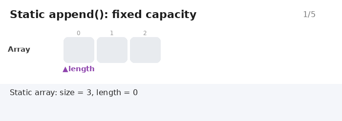</p>

**Dynamic** (`size = 2`): when full, `ensure_capacity` doubles the capacity and copies the old elements.

<p align="center">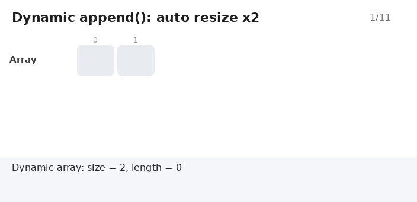</p>

Resize steps for `append(30)` when `size = 2` and `length = 2`:

| # | Step | State |
|:-:|---|---|
| 1 | The array is full | `│10│20│` |
| 2 | `ensure_capacity(3)` doubles `2 → 4` and allocates `new int[4]` | `│?│?│?│?│` |
| 3 | Copy the old elements (`for i < length`) | `│10│20│?│?│` |
| 4 | `delete[] Array`, then `Array = newArray`, `size = 4` | old memory released |
| 5 | `Array[length] = 30; length++` | `│10│20│30│_│` |

**Why double instead of growing by one?**
A resize copies every element, so growing by one slot would make every `append` cost `O(n)`. Doubling makes resizes rare (at 2, 4, 8, 16, ...), so the average cost per `append` is `O(1)`. This is called **amortized O(1)**.

| Append # | `size` before | What happens | `size` after |
|:-:|:-:|---|:-:|
| 1 | 2 | room available | 2 |
| 2 | 2 | room available | 2 |
| 3 | 2 | **resize** ×2 | 4 |
| 4 | 4 | room available | 4 |
| 5 | 4 | **resize** ×2 | 8 |

### 4.2 Line-by-line differences

| Part | `Static_Array.cpp` | `Dynamic_Array.cpp` |
|---|---|---|
| Class name | `Static_Array_Number` | `Dynamic_Array_Number` |
| Constructor `size` | `size >= 0` (can be `0`) | `size >= 1` (needs one slot to grow) |
| Private helpers | none | `resize()` and `ensure_capacity()` |
| `append` | returns `0` when full | grows automatically, always returns `1` |
| `insert` / `insert_sorted` | fail when full | grow automatically |
| `set_array` | returns `0` if `newLength > size` | grows with `ensure_capacity` |
| `merge` / `union_array` | new capacity = `size + arr2.size` | new capacity = `length + arr2.length` (at least `1`) |
| `intersection` | capacity = `min(size, arr2.size)` | same |
| `difference` | capacity unchanged | same |
| Failure message in `main` | `"Array is full!"` | `"Failed to add number!"` (practically unreachable) |
| Welcome title | `Welcome To Array Application` | `Welcome To Dynamic Array Application` |
| Capacity prompt | `Enter Array Capacity` | `Enter Starting Capacity` |

All other functions (`delete_index`, `linear_search`, `binary_search`, `get`, `set`, `max`, `min`, `sum`, `average`, `reverse`, `is_sorted`, `rearrange`, `display`, ...) are **identical** in both files.

---

## 5. Class Internals

### 5.1 Constructor

```cpp
Static_Array_Number(int Size, int Length, int* arr)
```

| Parameter | Meaning |
|---|---|
| `Size` | Requested capacity |
| `Length` | Number of elements to copy from `arr` initially |
| `arr` | Source array (`nullptr` means start empty) |

Input protection: a negative `Length` becomes `0`, `Length > size` is clamped to `size`, and `arr == nullptr` gives `length = 0`.
In `main()` it is called as `arr(size, 0, nullptr)`, an empty array with the capacity the user chose.

### 5.2 Destructor

```cpp
~Static_Array_Number() { delete[] Array; }
```

Releases the memory allocated with `new[]` when the object dies, which prevents a **memory leak**.

### 5.3 Copy Constructor and Assignment Operator (Deep Copy)

Without them C++ makes a **shallow copy** (copies the pointer, not the data) and two objects end up sharing one block of memory. When one is destroyed the other points to freed memory. The class performs a **deep copy** so each object owns its data.

<p align="center">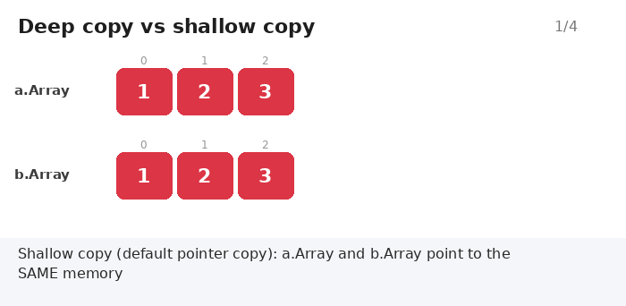</p>

Assignment operator (`b = a`) steps:

```text
1. if (this == &other) return *this;   // guard against b = b
2. delete[] Array;                     // release my old memory
3. size = other.size; length = other.length;
4. Array = new int[size];              // allocate new memory
5. copy the elements one by one
6. return *this;                       // allows a = b = c
```

Destructor + Copy Constructor + Assignment Operator together are known as the **Rule of Three**.

### 5.3.1 Private helpers (Dynamic only)

| Function | Role |
|---|---|
| `resize(newSize)` | Allocates a bigger array, copies the old one, frees the old one. **Never shrinks** (`if newSize <= size return`). |
| `ensure_capacity(required)` | Doubles `size` until it is enough for `required`, then calls `resize`. |

### 5.4 Getters and `set_array`

| Function | Returns |
|---|---|
| `get_size()` | Capacity |
| `get_length()` | Number of elements |
| `get_array()` | `const int*` for read-only access |
| `set_array(arr, newLength)` | Replaces the contents with a copy of `arr` |

---

## 6. Basic Operations

### 6.1 `append(value)`

Writes the value at `Array[length]` and increments `length`. Cost: `O(1)`. See the animations in [section 4.1](#41-append-when-the-array-is-full).

### 6.2 `insert(index, value)`

Valid range: `0 ≤ index ≤ length`. Shifts the elements from `index` to the end one slot **right**, then writes the value.

<p align="center">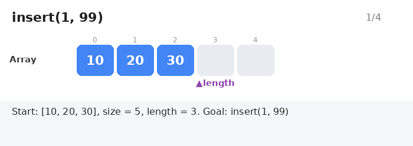</p>

| Frame | State | What happened |
|:-:|---|---|
| 0 | `│10│20│30│_│_│` | Start, `length = 3` |
| 1 | `│10│20│30│30│_│` | `Array[3] = Array[2]` |
| 2 | `│10│20│20│30│_│` | `Array[2] = Array[1]` |
| 3 | `│10│99│20│30│_│` | `Array[1] = 99`, `length = 4` |

> [!NOTE]
> Shifting goes **from the end to the start** so no value is overwritten before it has been moved.

### 6.3 `insert_sorted(value)`

**Precondition:** the array is already sorted ascending. Starting from the last element, every element **greater** than the value is shifted right, then the value is written into the gap.

<p align="center">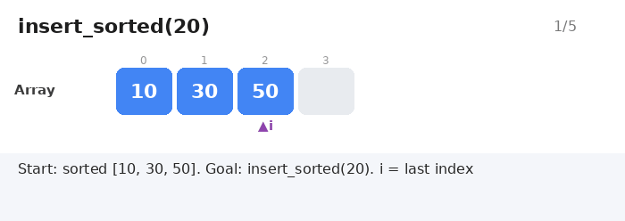</p>

### 6.4 `delete_index(index)`

Returns the **deleted value**, or `-1` for an invalid index. Shifts elements **left** to close the gap, then decrements `length`.

<p align="center">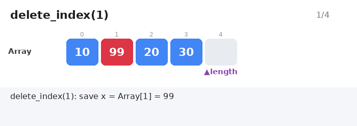</p>

The last slot `(30)` stays in memory but is now outside `length`, so it counts as removed.

### 6.5 `get(index, value)` and `set(index, value)`

| Function | Purpose | Returns |
|---|---|---|
| `get(index, value&)` | Reads the element into `value` (by reference) | `true` / `false` |
| `set(index, value)` | Changes an existing element | `1` / `0` |

Both are `O(1)` (direct indexing) and check `0 ≤ index < length`.

<p align="center">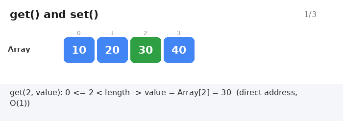</p>

---

## 7. Searching

### 7.1 `linear_search(key)`

Scans from the first element. No ordering required. Returns the index or `-1`.

<p align="center">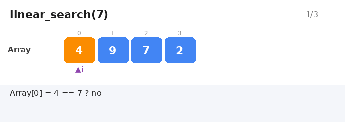</p>

### 7.2 `binary_search(key)`

**Precondition:** the array is sorted ascending. Each step discards half of the remaining range. The code uses `mid = low + (high - low) / 2` instead of `(low + high) / 2` to avoid **integer overflow**.

<p align="center">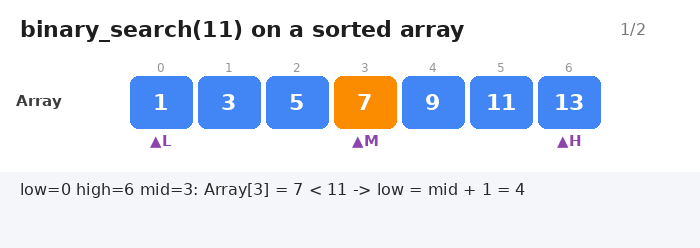</p>

---

## 8. Mathematical Operations

| Function | Returns | Notes |
|---|---|---|
| `max()` | Largest value | `-1` if empty |
| `min()` | Smallest value | `-1` if empty |
| `sum()` | Total as `long long` | `long long` avoids overflow |
| `average()` | Mean as `double` | `0.0` if empty |

`average()` converts the sum with `static_cast<double>` before dividing to avoid **integer division** (`7/2` gives `3.5`, not `3`). In `main()` an empty array is checked first and prints `"Array is empty!"`.

<p align="center">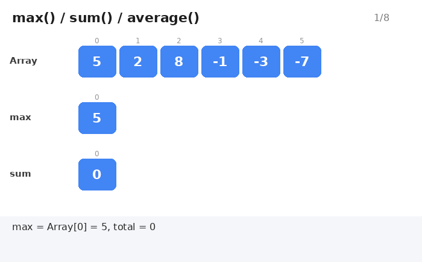</p>

---

## 9. Array Operations

### 9.1 `reverse()`

Two pointers (`start` from the front, `end` from the back) swap values until they meet. `O(n)` with no extra array.

<p align="center">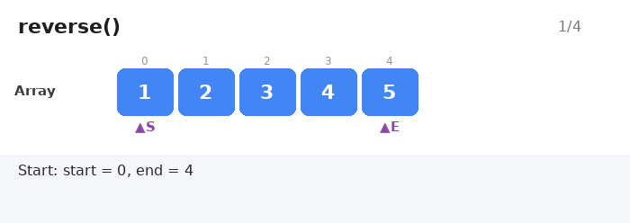</p>

### 9.2 `is_sorted()`

Compares each element with the next. The first time `Array[i] > Array[i+1]` it returns `0`; if it reaches the end it returns `1`.

<p align="center">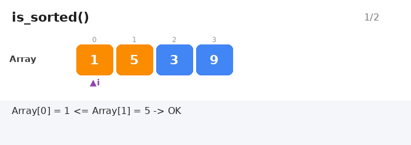</p>

```text
[1, 2, 2, 5]  ->  1   (sorted, duplicates allowed)
[1, 5, 3, 9]  ->  0   (5 > 3)
```

### 9.3 `rearrange()`

Moves all **negative** numbers to the front and non-negative numbers (including zero) to the back using two pointers `i` and `j`. It does **not** preserve the original order inside each group.

<p align="center">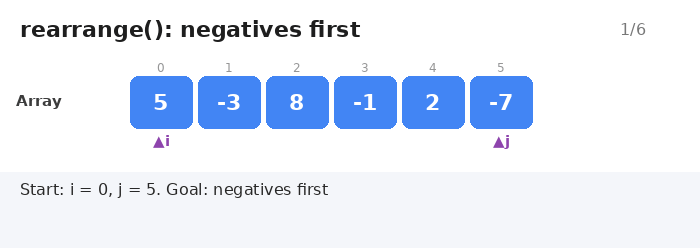</p>

---

## 10. Set Operations

> [!WARNING]
> 1. All four operations **assume both arrays are sorted ascending**. The code does **not** verify this.
> 2. The operation **modifies the original array (`arr`)** and stores the result in it. `arr2` is created temporarily in `main()` and destroyed afterwards.

All of them use the **two pointers** technique, so the cost is `O(n + m)` instead of `O(n × m)`.

Every example below uses:

```text
A = [1, 3, 5, 7, 9]        B = [3, 4, 5, 6, 7]
```

### 10.1 `merge`: keep duplicates

Compare `A[i]` and `B[j]` and take the smaller one. When they are equal the code takes from `B`.

<p align="center">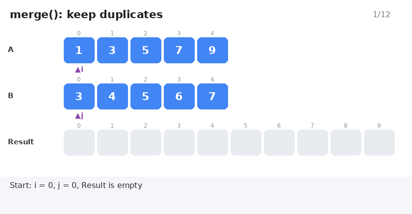</p>

**Result:** `1 3 3 4 5 5 6 7 7 9`

### 10.2 `union_array`: no duplicates

Same as merge, but a value is added only if it differs from the **last value added**.

<p align="center">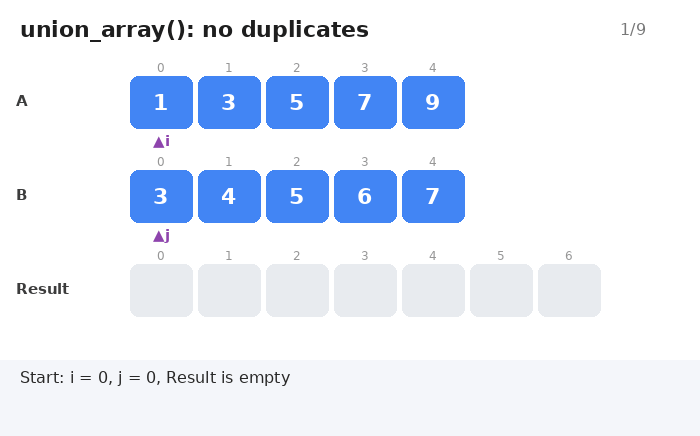</p>

**Result:** `1 3 4 5 6 7 9`

### 10.3 `intersection`: common values only

A value is added only if it exists in **both** arrays; otherwise the smaller side is skipped.

<p align="center">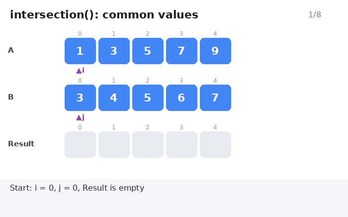</p>

**Result:** `3 5 7`

> The capacity after an intersection is `min(size, arr2.size)`, the logical upper bound for common elements.

### 10.4 `difference` (`A − B`)

Returns the elements that are in `A` and **not** in `B`.

<p align="center">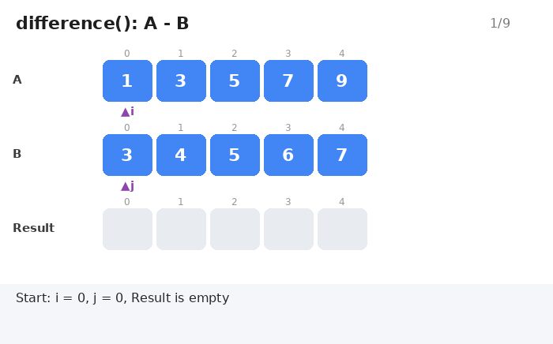</p>

**Result:** `1 9`

---

## 11. The Menu Program

### 11.1 Menu map

```text
Welcome  ->  "Enter Capacity:"  ->  arr(size, 0, nullptr)
                 |
                 v
             MAIN MENU
             ├── 1  Basic Operations
             │      ├─ 1 Append    2 Insert    3 Insert Sorted
             │      ├─ 4 Delete    5 Get       6 Set
             │      └─ 7 Back
             ├── 2  Search Operations
             │      ├─ 1 Linear    2 Binary
             │      └─ 3 Back
             ├── 3  Mathematical Operations
             │      ├─ 1 Max   2 Min   3 Sum   4 Average
             │      └─ 5 Back
             ├── 4  Array Operations
             │      ├─ 1 Reverse   2 Is Sorted   3 Rearrange
             │      └─ 4 Back
             ├── 5  Set Operations
             │      ├─ 1 Merge   2 Union   3 Intersection   4 Difference
             │      └─ 5 Back
             ├── 6  Array Information
             │      ├─ 1 Display   2 Capacity   3 Length
             │      └─ 4 Back
             └── 7  Exit
```

### 11.2 How the menu works

Each sub-menu is a `do { ... } while (choice != Back)` inside the main `do { ... } while (mainChoice != 7)`:

```text
do {                                    // Main Menu
    print menu -> read mainChoice
    if (mainChoice == 1) {
        do {                            // Sub Menu
            print sub menu -> read choice
            run the operation
        } while (choice != 7);          // until "Back"
    }
    else if (mainChoice == 2) { ... }
    ...
} while (mainChoice != 7);              // until "Exit"
```

### 11.3 `read_input(int& value)`

```cpp
void read_input(int& value)
{
    if (!(cin >> value))
    {
        cerr << "Input error: expected an integer." << endl;
        std::exit(EXIT_FAILURE);
    }
}
```

If the user types letters or anything that is not a number, the program **exits with an error** instead of looping forever.

### 11.4 How set operations run in `main()`

```text
1. Ask "second array capacity"   ->  arr2(size2, 0, nullptr)
2. Ask "How many numbers?"       ->  n
3. Repeat n times: read a number ->  arr2.append(value)
4. arr.merge(arr2)   (or union / intersection / difference)
5. Print the result with arr.display()
6. arr2 is destroyed automatically (destructor) at the end of the block
```

---

## 12. Sample Runs

**Dynamic** (starting capacity `2`, appending `10, 20, 30, 40, 50`):

```text
Enter Starting Capacity: 2
Number added successfully.      <- 10
Number added successfully.      <- 20
Number added successfully.      <- 30   (resize: 2 -> 4)
Number added successfully.      <- 40
Number added successfully.      <- 50   (resize: 4 -> 8)

Array Capacity = 8
Array Length   = 5
Array: 10 20 30 40 50
```

**Static** (capacity `3`, trying to append `10, 20, 30, 40`):

```text
Enter Array Capacity: 3
Number added successfully.      <- 10
Number added successfully.      <- 20
Number added successfully.      <- 30
Array is full!                  <- 40  (rejected)

Array Capacity = 3
Array Length   = 3
Array: 10 20 30
```

---

## 13. Code Review Notes

Both files compile without warnings under `-Wall -Wextra`, the logic is correct, and the animations follow the exact execution path of the code. The points below are **improvements**, not bugs that break the program.

| # | Note | Details and suggested fix |
|:-:|---|---|
| 1 | `delete_index` returns `-1` on error | If the deleted value is itself `-1`, `main()` prints `Invalid index!` incorrectly. Fix: `bool delete_index(int index, int& removed)`, same style as `get`. |
| 2 | Missing `#include` | `std::swap` and `std::min` are used without `#include <algorithm>`. It works on g++ but may fail on other compilers. |
| 3 | "Sorted" precondition is not checked | `binary_search`, `insert_sorted`, `merge`, `union_array`, `intersection`, and `difference` silently give wrong results on unsorted input. Fix: call `is_sorted()` first or print a warning. |
| 4 | The name `Static_Array` | The class allocates with `new` (heap) and `merge` / `union_array` change its capacity, so it is closer to a "Fixed-Capacity Array". |
| 5 | Silent data loss in Static set operations | If `arr2` has less capacity than `n`, `arr2.append(value)` fails and the value is dropped. Fix: print a message when `append` returns `0`. |
| 6 | `max()` / `min()` return `-1` for empty arrays | Can be confused with a real value. `main()` protects against it with `get_length() == 0`. |
| 7 | Assignment operator is not exception-safe | It calls `delete[]` **before** `new[]`; if `new` throws, the object is left invalid. Fix: **copy-and-swap idiom**. |
| 8 | Exit message | `Dynamic_Array.cpp` says `Array App` instead of `Dynamic Array App`. |

### Ideas for improvement

- Compare with `std::vector`, the standard library's dynamic array.
- Turn the class into a **template** (`template <typename T>`) to support `double` and `string`.
- Add `operator[]` so you can write `arr[2]` instead of `arr.get(2, x)`.
- Add `shrink_to_fit()` to the Dynamic version.
- Add unit tests (Catch2 or GoogleTest).

---

## 14. Final Comparisons

`n` = number of elements in the array, `m` = number of elements in the second array.

### 14.1 Static vs Dynamic vs `std::vector`

| Criterion | Static Array | Dynamic Array | `std::vector<int>` |
|---|---|---|---|
| Capacity | Fixed after creation (except set operations) | Doubles automatically | Grows automatically |
| When full | `append` returns `0` | Calls `resize` | Reallocates automatically |
| Minimum capacity | `0` | `1` | `0` |
| `append` | O(1) | O(1) amortized, O(n) at resize | O(1) amortized |
| Memory use | Exactly what was allocated | Up to about 2× the element count | Similar to Dynamic |
| Memory safety | Manual Rule of Three | Manual Rule of Three | Automatic (RAII) |
| Best for | Size known in advance | Size unknown | Real-world projects |

### 14.2 `linear_search` vs `binary_search`

| Criterion | Linear Search | Binary Search |
|---|---|---|
| Sorted input required | No | **Yes**, ascending |
| Time | O(n) | O(log n) |
| Best case | O(1) (first element) | O(1) (middle element) |
| 1,000,000 elements | up to 1,000,000 comparisons | about 20 comparisons |
| Unsorted input | Works correctly | **Wrong result, no warning** |

### 14.3 The four set operations (`A = [1,3,5,7,9]`, `B = [3,4,5,6,7]`)

| Operation | Result | Keeps duplicates? | Result capacity (Static) | Result capacity (Dynamic) | Time |
|---|---|:-:|---|---|:-:|
| `merge` | `1 3 3 4 5 5 6 7 7 9` | Yes | `size + arr2.size` | `length + arr2.length` | O(n + m) |
| `union_array` | `1 3 4 5 6 7 9` | No | `size + arr2.size` | `length + arr2.length` | O(n + m) |
| `intersection` | `3 5 7` | No | `min(size, arr2.size)` | `min(size, arr2.size)` | O(n + m) |
| `difference` (A − B) | `1 9` | No | unchanged `size` | unchanged `size` | O(n + m) |

### 14.4 Complete Big-O table

| Operation | Static | Dynamic | Animation |
|---|:-:|:-:|---|
| `get` / `set` | O(1) | O(1) | [get_set](animations/array_get_set.gif) |
| `append` | O(1) | O(1) amortized, O(n) at resize | [static](animations/array_append_static.gif) / [dynamic](animations/array_append_dynamic.gif) |
| `insert` | O(n) | O(n) | [insert](animations/array_insert.gif) |
| `insert_sorted` | O(n) | O(n) | [insert_sorted](animations/array_insert_sorted.gif) |
| `delete_index` | O(n) | O(n) | [delete](animations/array_delete.gif) |
| `linear_search` | O(n) | O(n) | [linear](animations/array_linear_search.gif) |
| `binary_search` | O(log n) | O(log n) | [binary](animations/array_binary_search.gif) |
| `max` / `min` / `sum` / `average` | O(n) | O(n) | [max_sum](animations/array_max_sum.gif) |
| `reverse` | O(n) | O(n) | [reverse](animations/array_reverse.gif) |
| `is_sorted` | O(n) | O(n) | [is_sorted](animations/array_is_sorted.gif) |
| `rearrange` | O(n) | O(n) | [rearrange](animations/array_rearrange.gif) |
| `merge` / `union` / `intersection` / `difference` | O(n + m) | O(n + m) | [merge](animations/array_merge.gif) / [union](animations/array_union.gif) / [intersection](animations/array_intersection.gif) / [difference](animations/array_difference.gif) |
| `display` | O(n) | O(n) | - |
| Copy Constructor / Assignment | O(n) | O(n) | [deep_copy](animations/array_deep_copy.gif) |
