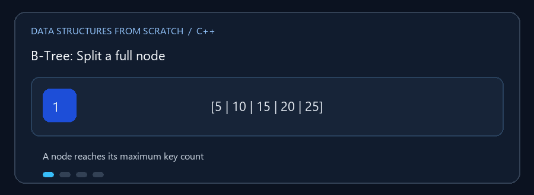

# B-Tree وB+ Tree

**English:** Learn how multi-key nodes split, borrow, and merge while keeping
tree height balanced. **بالعربي:** هنا هتفهم إزاي العقد اللي فيها مفاتيح كتير
بتتقسم أو تستعير أو تندمج عشان ارتفاع الشجرة يفضل متوازن.

## Animated walkthrough | شرح متحرك



The GIF shows a full node split and its median promoted to the parent. الـ GIF
بتوضح تقسيم عقدة ممتلئة ورفع المفتاح الأوسط للأب. الحد الفعلي للمفاتيح بيتحدد
حسب minimum degree المستخدم في البرنامج.

## Read the source step by step | اقرأ الكود بالترتيب

1. Find where each node stores sorted keys and child pointers. حدّد مكان
   مصفوفة المفاتيح المرتبة ومؤشرات الأبناء داخل العقدة.
2. Insertion follows the child whose key range contains the new value.
   الإضافة بتتبع الابن اللي مجال قيمه مناسب للمفتاح الجديد.
3. A full child splits; the median moves up and separates the children's
   ranges. الابن الممتلئ بيتقسم، والوسيط بيطلع للأب ويفصل مجالات القيم.
4. Deletion may borrow a key from a sibling or merge nodes. الحذف ممكن
   يستعير مفتاح من أخ أو يدمج عقد عشان يحافظ على الحد الأدنى للمفاتيح.
5. B+ Tree links its leaves, making sorted scans across leaf values direct.
   أوراق B+ Tree مترابطة، وده بيخلّي المرور على القيم المرتبة متتابعاً.

**When useful / الاستخدام:** A node holds several keys, keeping the tree
shallow. This makes multiway trees useful for learning file and database
indexes. العقدة الواحدة بتحتفظ بعدة مفاتيح، فعدد المستويات بيقل؛ وده مفيد لفهم
فهارس الملفات وقواعد البيانات.

تخزّن البنيتان أكثر من مفتاح في العقدة الواحدة؛ وهذا يقلل عدد مستويات الشجرة
ويجعلها مناسبة لفهم فهارس البيانات والقرص.

## الملفات

- `B_Tree.cpp` — بحث وإضافة وحذف ومدى مرتب ومعلومات عن الارتفاع والدرجة.
- `B_Plus_Tree.cpp` — بحث وإضافة وعرض مرتب عبر أوراق مترابطة، مع عمليات
  الاستعلام التي يوفرها البرنامج.

## الفرق

في B-Tree يمكن أن توجد القيم في العقد الداخلية والأوراق. في B+ Tree تتركز
السجلات في الأوراق، وتُستخدم المفاتيح الداخلية للتوجيه؛ ربط الأوراق يسمح
باجتياز القيم بترتيبها.

### 🎬 انقسام عقدة عند الامتلاء

```text
عقدة ممتلئة:      [ 5 | 10 | 15 | 20 | 25 ]
                    /         |          \
بعد التقسيم:       [5,10]   15 للأعلى   [20,25]
```

المفتاح الوسيط يصعد إلى الأب. قد يتكرر ذلك حتى الجذر، وعندها ينشأ جذر جديد.
الحذف قد يحتاج دمج عقد أو استعارة مفاتيح من شقيق لإرجاع حدود الامتلاء.

## التعقيد

البحث والإضافة والحذف `O(log n)` بالنسبة لعدد القيم، مع عدد مستويات منخفض
يتأثر بالدرجة الدنيا التي يختارها البرنامج. المرور على `k` نتائج مرتبة
`O(log n + k)` عادةً.

## التشغيل

كل ملف مستقل ويحتوي على قائمة تفاعلية:

```powershell
g++ -std=c++17 -Wall -Wextra .\B_Tree.cpp -o .\btree.exe
.\btree.exe
```

لتجربة B+ Tree بدّل اسم الملف والبرنامج التنفيذي إلى `B_Plus_Tree.cpp`.
