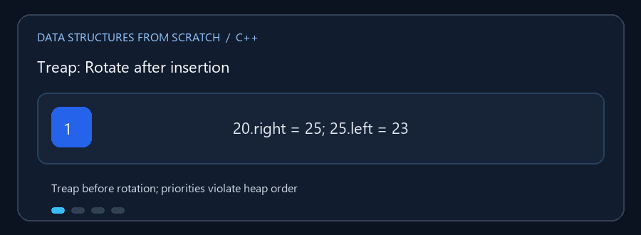

# الأشجار المتوازنة

**English:** Compare two search-tree strategies that keep tree height small.
**بالعربي:** المجلد ده بيقارن طريقتين للحفاظ على شجرة البحث متوازنة عشان البحث
والإضافة والحذف يفضلوا سريعين مع زيادة القيم.

## Animated walkthrough | شرح متحرك



The GIF focuses on a Treap rotation. A local rotation changes links but keeps
the binary-search ordering intact. الـ GIF بتركز على دوران Treap: الروابط
بتتغير محلياً لكن ترتيب BST بيفضل محفوظ. قواعد Red-Black بتضيف تلوين وإصلاحات.

## Read the source step by step | اقرأ الكود بالترتيب

1. Follow left/right links to understand the BST ordering. تابع روابط الشمال
   واليمين لتفهم ترتيب المفاتيح.
2. In `Treap.cpp`, inspect both each key and its priority. Insertion may
   rotate when the priority rule is broken. في Treap راقب شرطين: ترتيب القيم
   وترتيب الأولويات؛ الدوران بيحصل عند كسر شرط الأولوية.
3. In `Red_Black_Tree.cpp`, follow parent pointers and node colors, then see
   how `fix_insert`/`fix_erase` restore the rules. في Red-Black تابع الأب
   والألوان وشوف دوال الإصلاح بعد التغيير.
4. Test sorted input: a balanced tree should not become a one-sided chain.
   جرّب إدخال قيم مرتبة وتأكد إن الشجرة ما تتحولش لسلسلة من ناحية واحدة.

**Why balance? / أهمية التوازن:** An ordinary BST may reach height `n`; a
balanced tree keeps height close to `log2(n)`. That shortens the path a search
must follow. شجرة البحث العادية ممكن ارتفاعها يوصل `n`، لكن التوازن بيخلي
الارتفاع قريب من `log2(n)` ويقلل عدد الخطوات.

تطبيقان يحافظان على ارتفاع الشجرة لتجنب أن تتحول عمليات البحث والإضافة إلى
مرور خطي في الحالات المعتادة.

## الملفات

- `Red_Black_Tree.cpp` — شجرة بحث ثنائية ملوّنة بقواعد Red-Black؛ تشمل الإضافة
  والحذف والبحث والعرض ومعلومات الشجرة.
- `Treap.cpp` — تجمع بين ترتيب BST حسب القيمة وترتيب Heap حسب أولوية مولّدة؛
  تشمل الإضافة والحذف والبحث والعرض.

## الفكرة

في BST التقليدية قد ينتج عن إدخال قيم مرتبة خط مستقيم. الأشجار المتوازنة تضيف
قواعد لإعادة تشكيل الروابط بحيث يبقى الارتفاع قريباً من `log2(n)`.

### 🎬 حركة Treap بعد إدخال قيمة

نفترض أن إدخال `25` جعل أولوية العقدة أعلى من أبيها:

```text
قبل:                 بعد الدوران:
       20                    25
         \                  /
          25               20
          /                  \
         23                   23
```

الدوران يغيّر الروابط المحلية مع الحفاظ على ترتيب قيم BST. في Red-Black قد
تتبع الإضافة أو الحذف إعادة تلوين ودوران لإرجاع قواعد الألوان.

## التعقيد

| العملية | Red-Black | Treap |
|---|---:|---:|
| بحث / إضافة / حذف | `O(log n)` مضمون | `O(log n)` متوقع؛ `O(n)` أسوأ حالة |
| مساحة التخزين | `O(n)` | `O(n)` |

الأولوية في هذا التنفيذ مولدة بخوارزمية pseudo-random ثابتة البذرة؛ لذلك
`O(log n)` وصف متوقع، وليس ضماناً صارماً لكل ترتيب إدخال. In this
implementation the Treap uses a deterministic pseudo-random generator with a
fixed seed, so the expected balance is not a worst-case guarantee.

## التشغيل

```powershell
g++ -std=c++17 -Wall -Wextra .\Red_Black_Tree.cpp -o .\red_black.exe
.\red_black.exe
```

ترجم `Treap.cpp` منفرداً بالطريقة نفسها. كل ملف برنامج تفاعلي مستقل.
