<div align="center">

# Balanced Binary Search Trees in C++

**Red-Black Tree &nbsp;vs&nbsp; Treap**

شرح عملي لشجرتين متوازنتين في C++ مع أنيميشن لكل عملية


</div>

---

## Overview

Both files store unique integers in a **Binary Search Tree (BST)** that keeps itself balanced, so search, insert, and erase stay fast (`O(log n)`) even for sorted input. They differ in **how** they stay balanced.

الملفين بيخزنوا أرقام صحيحة من غير تكرار في شجرة بحث ثنائية بتوازن نفسها لوحدها. الفرق بينهم في **طريقة التوازن**.

| File | Class | How it stays balanced |
|---|---|---|
| `Red_Black_Tree.cpp` | `Red_Black_Tree` | **Colors + rotations.** ضمان صارم في أسوأ حالة. |
| `Treap.cpp` | `Treap` | **Random priorities + rotations.** ضمان احتمالي (متوقع). |

Both programs expose the same interactive menu: Insert, Search, Erase, Display, Minimum, Maximum, Clear, Size.

## Table of Contents

1. [Project Structure](#1-project-structure)
2. [Build and Run](#2-build-and-run)
3. [BST Basics and Rotations](#3-bst-basics-and-rotations)
4. [Red-Black Tree](#4-red-black-tree)
5. [Treap](#5-treap)
6. [Shared Operations](#6-shared-operations-search-minmax-display)
7. [Class Internals](#7-class-internals)
8. [The Menu Program](#8-the-menu-program)
9. [Code Review Notes](#9-code-review-notes)
10. [Final Comparisons](#10-final-comparisons)

---

## How to Read the Animations

| Marker | Meaning |
|:-:|---|
| Red / dark circle | Red-Black node color (RED or BLACK) |
| Teal circle with `p=..` | Treap node: big number is the value, `p` is the priority |
| Blue circle | Neutral node (used in the rotation demo) |
| 🟧 Orange ring | Node being processed right now |
| 🟩 Green ring | Success: found, finished, or in its final place |
| 🟪 Purple ring | Related nodes (parent, uncle, sibling, subtrees being merged) |
| 🟥 Red ring | Node being erased, or a failed search |
| ⬜ Gray ring | Nodes already visited |
| `z` `P` `U` `G` | New node, Parent, Uncle, Grandparent (insert fix-up) |
| `x` `P` `S` | Problem spot, Parent, Sibling (erase fix-up) |
| Black square `x = nil` | The "double black" spot: an empty (nil) position |

The caption under each frame explains the step. Every animation is generated by simulating the same steps as the C++ code.

---

## 1. Project Structure

```text
BalancedTree/
├── README.md
├── Red_Black_Tree.cpp
├── Treap.cpp
└── animations/              # all GIFs used in this README
    ├── rbt_rotations.gif
    ├── rbt_insert_rotation.gif
    └── ...
```

Each `.cpp` file has three parts: the **class**, a `read_integer()` helper, and a menu-driven `main()`. Defining `RED_BLACK_TREE_TEST` or `TREAP_TEST` removes `main()` so the class can be reused in a test file.

## 2. Build and Run

```bash
g++ -std=c++17 -Wall -Wextra Red_Black_Tree.cpp -o red_black_tree
./red_black_tree

g++ -std=c++17 -Wall -Wextra Treap.cpp -o treap
./treap
```

> On Windows use `red_black_tree.exe` instead of `./red_black_tree`.

---

## 3. BST Basics and Rotations

In a BST every node follows one rule: **smaller values go left, larger values go right**. If you insert `1, 2, 3, 4, ...` in order, a plain BST becomes a linked list and every operation costs `O(n)`. Balanced trees fix this by reshaping the tree after each change.

The reshaping tool is the **rotation**. A rotation changes the shape of a small part of the tree **without** changing the sorted (in-order) order.

<p align="center">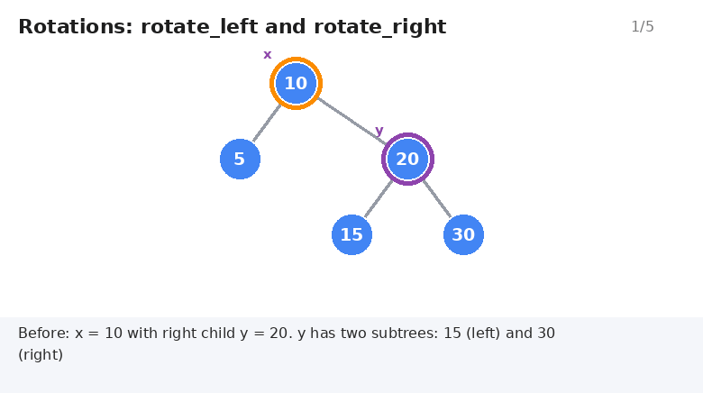</p>

```text
      x                          y
     / \      rotate_left(x)    / \
    A   y     ------------->   x   C
       / \    <-------------  / \
      B   C   rotate_right(y) A  B
```

| Function | What it does |
|---|---|
| `rotate_left(x)` | `x`'s right child `y` moves up, `x` becomes `y`'s left child, `y`'s old left subtree becomes `x`'s right subtree |
| `rotate_right(y)` | The mirror image of `rotate_left` |

Both are `O(1)`. Both files contain these two functions: the Red-Black Tree version also fixes `parent` pointers, the Treap version is simpler (no parent pointers).

---

## 4. Red-Black Tree

### 4.1 The five rules

| # | Rule |
|:-:|---|
| 1 | Every node is **RED** or **BLACK** |
| 2 | The **root** is BLACK |
| 3 | Every leaf (the `nil` sentinel) is BLACK |
| 4 | A RED node never has a RED child (**no red-red**) |
| 5 | Every path from a node down to its nil leaves has the **same number of BLACK nodes** (black-height) |

Rules 4 and 5 together guarantee that the longest path is at most **twice** the shortest, so the height is always `≤ 2·log₂(n + 1)`.

A new node is always inserted **RED** (this never breaks rule 5, it can only break rule 4).

### 4.2 Insert and the fix-up (`fix_insert`)

After a normal BST insert, if the new node `z` has a RED parent, we have a red-red conflict. The **uncle** `U` (the parent's sibling) decides what to do:

| Case | Uncle | Shape | Action | Rotations |
|:-:|---|---|---|:-:|
| 1 | RED | any | Recolor `P` and `U` BLACK, `G` RED, continue from `G` | 0 |
| 2 | BLACK / nil | triangle (inner child) | Rotate `P` to turn it into a straight line, then case 3 | 1 |
| 3 | BLACK / nil | straight line (outer child) | `P` BLACK, `G` RED, rotate `G` | 1 |

At the end the root is recolored BLACK.

**Case 3: uncle is nil, straight line** (insert `10, 20, 30`)

<p align="center">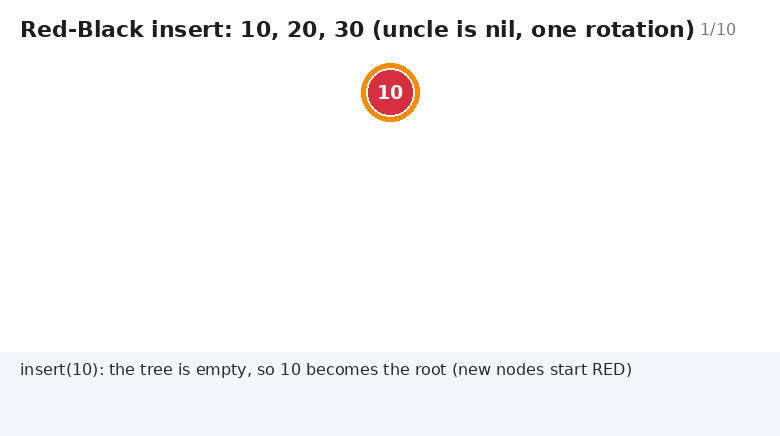</p>

**Case 1: uncle is RED** (insert `1` into `10, 5, 15`). No rotation, only recoloring, and the problem moves up the tree.

<p align="center">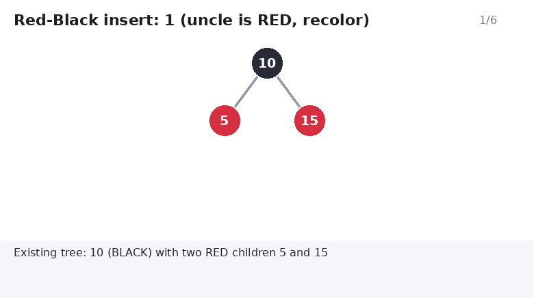</p>

**Case 2 then 3: triangle** (insert `15` into `10, 20`). Two rotations.

<p align="center">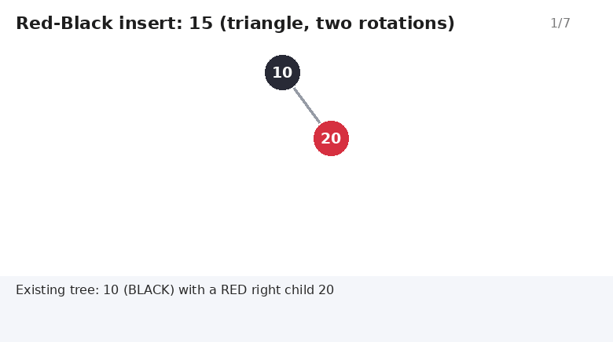</p>

> [!NOTE]
> The code handles the mirror cases (parent is a right child) with the same logic. The animations show whichever side the example needs.

### 4.3 Erase and the fix-up (`fix_erase`)

`erase` removes the node like a normal BST, using `transplant` to replace subtrees:

| Node to erase | What happens |
|---|---|
| No left child | Its right child takes its place |
| No right child | Its left child takes its place |
| Two children | Replaced by its **successor** (the minimum of the right subtree), which takes the erased node's color |

The code remembers the **original color** of the node that was removed or moved:

- **RED**: no rule is broken, done.
- **BLACK**: black-height changed, so `fix_erase(x)` runs. `x` is the "double black" spot (often the `nil` sentinel).

**Two children** (erase the root `10`). The successor `12` moves up. It was RED, so no fix-up is needed.

<p align="center">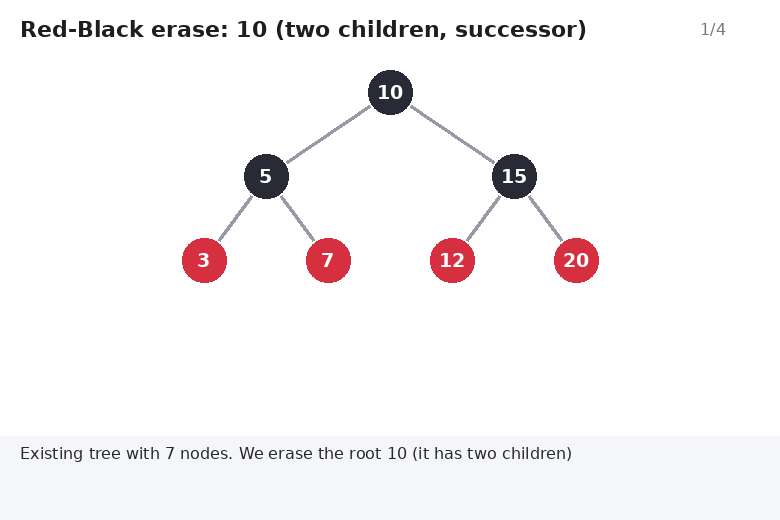</p>

The fix-up has four cases. `S` is the sibling of `x`; the "far" child of `S` is the one on the opposite side from `x`:

| Case | Situation | Action | Result |
|:-:|---|---|---|
| 1 | `S` is RED | `S` BLACK, `P` RED, rotate `P` toward `x` | Converts to case 2, 3, or 4 |
| 2 | `S` BLACK, both its children BLACK | `S` RED, move `x` up to `P` | Problem moves up (may repeat) |
| 3 | `S` BLACK, far child BLACK, near child RED | Recolor, rotate `S` away from `x` | Converts to case 4 |
| 4 | `S` BLACK, far child RED | `S` takes `P`'s color, `P` and far child BLACK, rotate `P` toward `x` | **Done** |

**Case 2: recolor** (erase `15` when all nodes are BLACK)

<p align="center">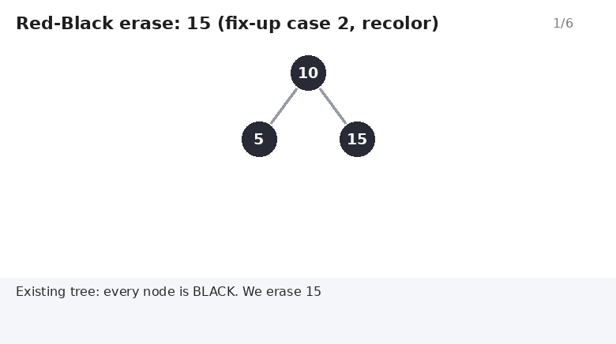</p>

**Case 4: rotation** (erase `15` when the sibling has a RED far child)

<p align="center">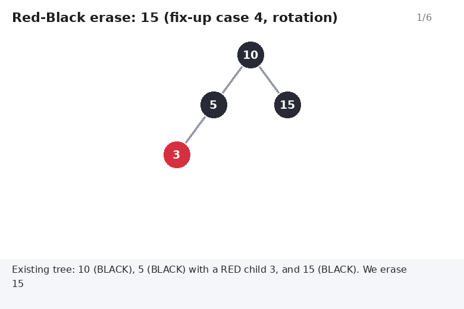</p>

> [!IMPORTANT]
> Rotation limits: insert uses **at most 2** rotations, erase uses **at most 3**. This is why Red-Black Trees are popular for libraries (`std::set` and `std::map` are usually Red-Black Trees).

---

## 5. Treap

**Treap = Tree + Heap.** Every node has a **value** (the key) and a random **priority**. The tree obeys two rules at the same time:

| Rule | Order by | Direction |
|---|---|---|
| BST rule | **value** | smaller left, larger right |
| Heap rule | **priority** | parent priority `>` child priority (max-heap) |

For a given set of values and priorities there is exactly **one** possible Treap shape. With random priorities the shape behaves like a random BST, which is balanced with high probability. That gives **expected** `O(log n)` for every operation.

### 5.1 Priorities in the code

```cpp
randomState = randomState * 1664525u + 1013904223u;   // a small LCG
```

A tiny deterministic generator gives each new node a 32-bit priority. It makes runs **reproducible** and avoids the global `rand()` state. The animations use small priorities (like `p=90`) for readability; the real ones are large 32-bit numbers.

### 5.2 Insert (`insert_node`)

1. Insert like a normal BST (new leaf).
2. On the way back up the recursion, if a child has a **higher priority** than its parent, rotate the child above the parent.
3. Stop when the heap rule holds.

<p align="center">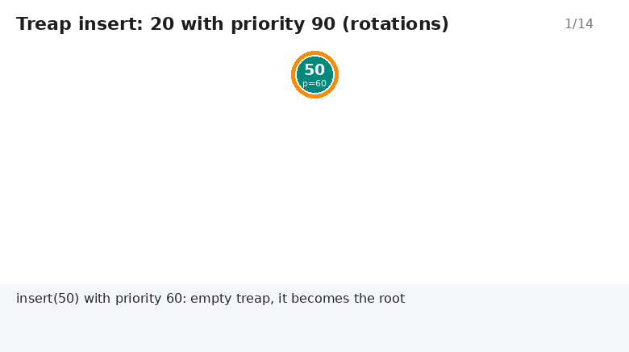</p>

In the example `20` (priority 90) is inserted as a leaf, then two `rotate_right` calls lift it all the way to the root. The code uses **recursion**, so it needs no `parent` pointers.

### 5.3 Erase (`erase_node` and `merge`)

Treap erase does not use fix-up cases. It removes the node and **merges** its two subtrees with `merge(left, right)`:

- Compare the priorities of the two roots.
- The root with the **higher** priority becomes the root of the result.
- Recursively merge the rest (its right subtree with the other tree, or its left subtree with the other tree).

Merging is valid because every value in `left` is smaller than every value in `right`.

<p align="center">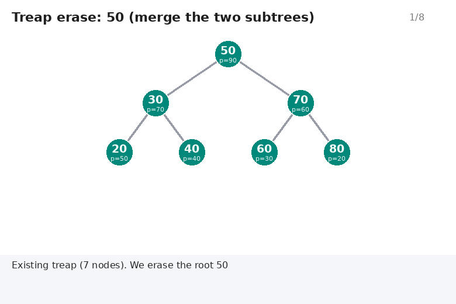</p>

---

## 6. Shared Operations: Search, Min/Max, Display

These operations are plain BST code and **do not change the tree**, so Red-Black colors and Treap priorities are ignored.

### 6.1 `contains(value)`

Start at the root; if the value is smaller go left, if larger go right, stop when found or when you reach `nil` / `nullptr`. Cost: `O(height)`, which is `O(log n)` in a balanced tree.

<p align="center">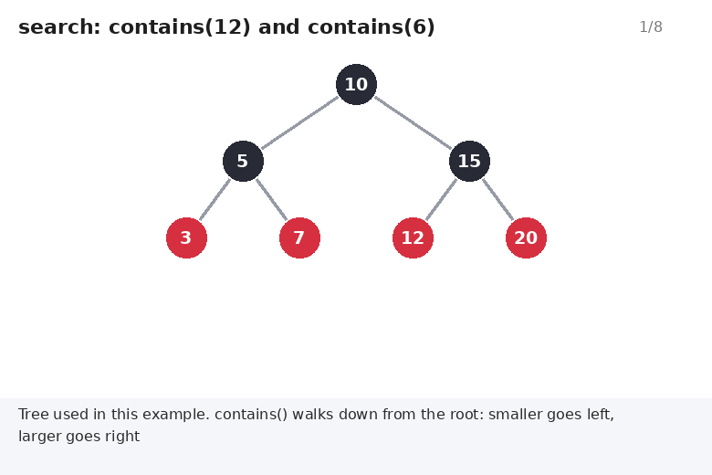</p>

Same operation in a Treap:

<p align="center">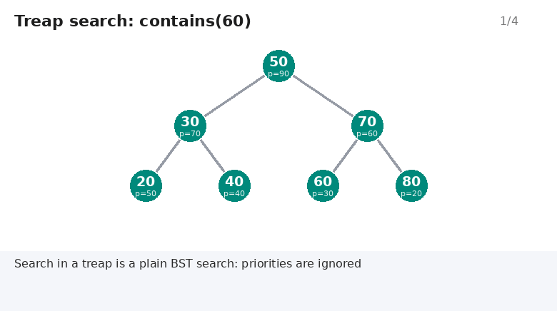</p>

### 6.2 `minimum()` and `maximum()`

The minimum is the **leftmost** node, the maximum is the **rightmost** node. Both return `false` for an empty tree and give the value through a reference parameter.

<p align="center">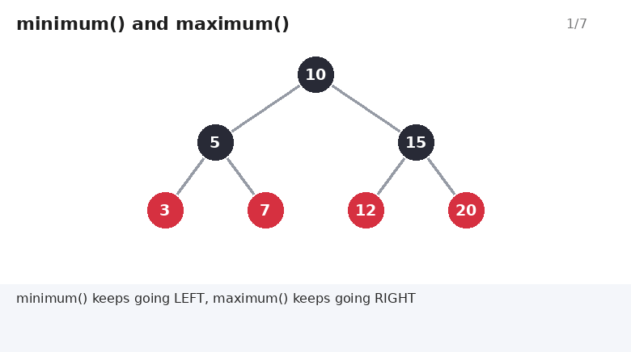</p>

### 6.3 `display()`

An **in-order** traversal (left, node, right) prints the values in sorted order. For an empty tree it prints `"The tree is empty."` (Red-Black) or `"The treap is empty."` (Treap).

<p align="center">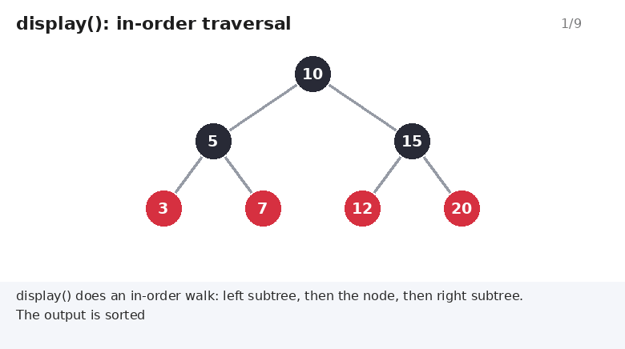</p>

### 6.4 `size()` and `clear()`

`size()` returns the stored counter `length` in `O(1)`. `clear()` deletes every node and resets `length` to `0`.

---

## 7. Class Internals

### 7.1 Node layout

```cpp
struct RedBlackNode {                 struct TreapNode {
    int data;                             int data;
    NodeColor color;                      uint32_t priority;
    RedBlackNode* left;                   TreapNode* left;
    RedBlackNode* right;                  TreapNode* right;
    RedBlackNode* parent;             };
};
```

| | Red-Black node | Treap node |
|---|---|---|
| Extra data | 1 color (`RED` / `BLACK`) | 1 priority (`uint32_t`) |
| Pointers | `left`, `right`, `parent` | `left`, `right` |
| Parent pointer needed? | **Yes** (fix-up walks upward) | **No** (recursion walks back up) |

### 7.2 The `nil` sentinel (Red-Black Tree only)

Instead of `nullptr`, the Red-Black Tree uses **one shared BLACK node** called `nil` for every missing child and for the root's parent. Its `left`, `right`, and `parent` all point to itself.

```text
        root(10)
        /      \
     (5)       (15)
    /   \     /    \
  nil   nil  nil   nil     <- all the same single object
```

This removes `nullptr` checks, because `node->color` is always safe to read (rule 3 comes for free). The fix-up can even set `nil->parent` temporarily, and `erase` resets it with `nil->parent = nil;` at the end.

### 7.3 Rule of Three

| Member | Red-Black Tree | Treap |
|---|---|---|
| Destructor | `destroy_tree(root)` then `delete nil` | `destroy_tree(root)` |
| Copy constructor | Deep copy with `clone_tree` (keeps colors and rebuilds `parent` pointers) | Deep copy with `copy_tree` (keeps priorities and the generator state) |
| Assignment | **Copy-and-swap** | **Copy-and-swap** |
| `swap` | Swaps `root`, `nil`, `length` | Swaps `root`, `length`, `randomState` |

Both copy constructors are **exception safe**: if a `new` throws in the middle, the partly built copy is deleted before the exception continues.

**Copy-and-swap** (`operator=`):

```cpp
if (this != &other)
{
    Red_Black_Tree copy(other);   // 1. build a full copy first (may throw)
    swap(copy);                   // 2. swap: never throws
}                                 // 3. `copy` now owns the old data and is destroyed
return *this;
```

If step 1 throws, the original object is untouched.

### 7.4 Return values

| Function | Returns |
|---|---|
| `insert(value)` | `true` if inserted, `false` if the value already exists (**duplicates are rejected**) |
| `erase(value)` | `true` if erased, `false` if not found |
| `contains(value)` | `true` / `false` |
| `minimum(int&)` / `maximum(int&)` | `true` and fills the value, or `false` if empty |

---

## 8. The Menu Program

```text
--- Red-Black Tree ---   (or  --- Treap ---)
1. Insert
2. Search
3. Erase
4. Display sorted values
5. Minimum
6. Maximum
7. Clear
8. Size
0. Exit
```

- For options 1 to 3 the program asks `Enter an integer:` through `read_integer()`.
- A non-number is rejected with `Invalid input...`, the bad input is cleared with `cin.clear()` and `cin.ignore(...)`, and the menu is shown again.
- End of input (`Ctrl+D` / `Ctrl+Z`) exits cleanly.

**Sample run:**

```text
Choose an option: 1
Enter an integer: 10
Value inserted.
Choose an option: 1
Enter an integer: 10
Duplicate value; no change.
Choose an option: 4
10
Choose an option: 8
Size: 1
```

---

## 9. Code Review Notes

Both files are well structured and the animations follow the exact steps of the code. The points below are **suggestions**, not bugs.

| # | Note | Suggestion |
|:-:|---|---|
| 1 | `destroy_tree` and `destroy_partial` are identical in `Red_Black_Tree.cpp` | Keep only one |
| 2 | `size_t` is used with only `<iostream>` included | Add `#include <cstddef>` (and keep `<cstdint>` in the Treap) |
| 3 | `display`, `destroy`, and `clone` are recursive | Fine for balanced trees. In a Treap the depth is only expected `O(log n)`, so an unlucky shape is theoretically deeper |
| 4 | `Treap::clear()` resets `randomState` to the initial seed | The same priority sequence repeats after a clear. Good for reproducible tests, but predictable |
| 5 | The LCG is simple and deterministic | If inputs could be chosen by an attacker, use `std::mt19937` seeded with `std::random_device` |
| 6 | No way to verify the Red-Black rules | Add a `validate()` method that checks rules 2, 4, 5 for unit tests |
| 7 | Only `int` values | Make the classes `template <typename T, typename Compare = std::less<T>>` |
| 8 | No ordered queries | Add `lower_bound`, `successor`, `predecessor`, or an iterator |
| 9 | `#ifndef ..._TEST` guards | Good practice. Document them in comments so test files know the macro names |

---

## 10. Final Comparisons

`n` = number of nodes, `h` = tree height.

### 10.1 Red-Black Tree vs Treap

| Criterion | Red-Black Tree | Treap |
|---|---|---|
| Balance idea | Color rules + black-height | Random priorities (BST + heap) |
| Balance guarantee | **Worst case**, always | **Expected** (probabilistic) |
| Height | `≤ 2·log₂(n + 1)` | Expected `O(log n)` |
| Search | O(log n) | Expected O(log n) |
| Insert | O(log n) worst | Expected O(log n) |
| Erase | O(log n) worst | Expected O(log n) |
| Rotations per insert | At most 2 | Expected O(1) |
| Rotations per erase | At most 3 | None, uses `merge` |
| Extra data per node | 1 color | 1 priority (4 bytes) |
| Pointers per node | 3 (`left`, `right`, `parent`) | 2 (`left`, `right`) |
| Needs `parent` pointer | Yes | No |
| Needs sentinel `nil` | Yes (in this code) | No (`nullptr`) |
| Implementation difficulty | **High** (many cases, mirrored) | **Low** (rotate + merge) |
| Deterministic behavior | Yes | Only with a fixed seed (this code) |
| Best for | Libraries, real-time, guaranteed latency | Simple code, split/merge, competitive programming |

### 10.2 Where the two trees do the same thing

| Operation | Code | Cost |
|---|---|---|
| `contains` | iterative BST walk | O(h) |
| `minimum` / `maximum` | follow `left` / `right` | O(h) |
| `display` | in-order recursion | O(n) |
| `size` | stored counter | O(1) |
| `clear` | post-order delete | O(n) |
| Copy / assignment | deep copy + copy-and-swap | O(n) |

### 10.3 Insert and erase side by side

| Step | Red-Black Tree | Treap |
|---|---|---|
| 1. Insert | BST insert as a RED leaf | BST insert as a leaf with a random priority |
| 2. Repair | `fix_insert`: 3 cases (recolor or 1-2 rotations) | Rotate up while child priority > parent priority |
| 3. Erase | `transplant` + successor if two children | Replace the node with `merge(left, right)` |
| 4. Repair | `fix_erase` only if a BLACK node was removed: 4 cases | None |
| Animations | [rotations](animations/rbt_rotations.gif), [insert 3 cases](animations/rbt_insert_rotation.gif), [erase 3 examples](animations/rbt_erase_rotation.gif) | [insert](animations/treap_insert.gif), [erase](animations/treap_erase.gif) |

### 10.4 Complexity summary

| Operation | Red-Black Tree | Treap | Animation |
|---|:-:|:-:|---|
| `insert` | O(log n) | O(log n) expected | [RB](animations/rbt_insert_rotation.gif) / [Treap](animations/treap_insert.gif) |
| `erase` | O(log n) | O(log n) expected | [RB](animations/rbt_erase_two_children.gif) / [Treap](animations/treap_erase.gif) |
| `contains` | O(log n) | O(log n) expected | [RB](animations/rbt_search.gif) / [Treap](animations/treap_search.gif) |
| `minimum` / `maximum` | O(log n) | O(log n) expected | [min_max](animations/rbt_min_max.gif) |
| `display` | O(n) | O(n) | [in-order](animations/inorder_display.gif) |
| `size` | O(1) | O(1) | - |
| `clear` | O(n) | O(n) | - |
| Copy / assignment | O(n) | O(n) | - |
| Rotation | O(1) | O(1) | [rotations](animations/rbt_rotations.gif) |
