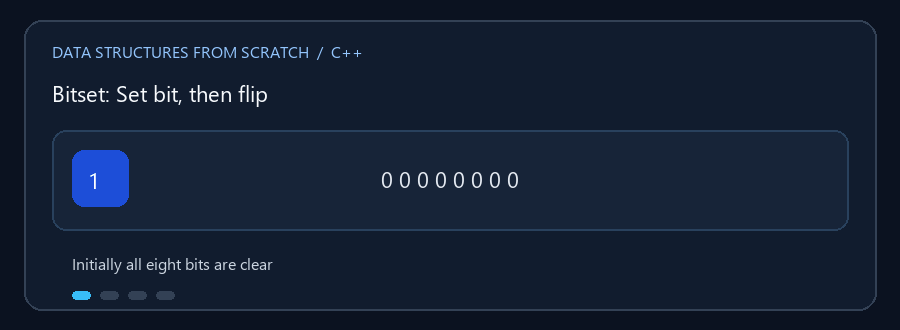

# Bitset

**English:** Store many Boolean flags compactly, then combine them using
bitwise set operations. **بالعربي:** خزّن حالات كتير من نوع صح/غلط في مساحة
صغيرة، ونفّذ عمليات المجموعات مباشرة على البتات.

## Animated walkthrough | شرح متحرك



The animation sets bit 5 and bit 2, then flips bit 2 off again. Bit index 0
appears at the right in the program's display. الـ GIF بتضبط البت 5 وبعده 2،
وبعدين تقلب 2 للصفر. في عرض البرنامج الفهرس صفر ناحية اليمين.

## Read the source step by step | اقرأ الكود بالترتيب

1. `bitCount` is the number of valid bit positions; internal words store
   several bits each. `bitCount` هو عدد البتات المتاحة، والكلمات الداخلية
   بتخزن عدة بتات مع بعض.
2. `set`, `reset`, and `flip` use `index / 64` to choose a word and
   `index % 64` to choose a bit. القسمة تحدد الكلمة الداخلية وباقي القسمة
   يحدد البت داخلها.
3. `test` reads one bit; `count`, `any`, `none`, and `all` summarize the set.
   `test` بتقرأ بت، وباقي الدوال بتحسب أو تلخص محتوى المجموعة.
4. Union, intersection, XOR, and difference require equal bit counts.
   الاتحاد والتقاطع وXOR والفرق محتاجين طولين متساويين.

**Boundary case / حالة حدودية:** An index equal to `size()` is invalid. Extra
bits in the final machine word are masked so they cannot leak into results.
الفهرس المساوي لـ `size()` غير صالح. البتات الزائدة في آخر كلمة داخلية لازم
تتصفّر عشان ما تدخلش بالغلط في النتائج.
For a zero-length Bitset, `all()` returns true (there is no unset valid bit).
لو طول الـ Bitset صفر، `all()` بترجع true لأنه مفيش بت صالح قيمته صفر.

`Bitset.cpp` يطبق مجموعة من البتات بطول محدد. كل موضع يحمل `0` أو `1`، وتسمح
البتات بتخزين أعلام كثيرة بمساحة أقل من تخزين قيمة صحيحة مستقلة لكل عنصر.

## العمليات

يتضمن التطبيق ضبط بت (`set`)، تصفيره (`reset`)، قلبه (`flip`)، اختباره
(`test`)، عدّ البتات المضبوطة، واختبار `any` و`none` و`all`. تشمل عمليات
المجموعات الاتحاد (`union`)، التقاطع (`intersection`)، XOR، والفرق
(`difference`). يجب أن يكون طول الـ Bitsetين متساوياً لهذه العمليات.
الفهرس صالح عندما يكون أصغر من عدد البتات؛ العرض يضع الفهرس صفر في أقصى اليمين.

### 🎬 قلب بت واحد

```text
الفهرس:  0 1 2 3 4 5 6 7
قبل:     0 0 1 0 0 0 0 0
flip(2): 0 0 0 0 0 0 0 0
set(5):  0 0 0 0 0 1 0 0
```

عمليات بت مفردة `O(1)`، وعمليات التجميع على `n` بتات `O(n)` تقريباً. المساحة
`O(n)` بت، مع وجود حمل تخزين إضافي بسيط بحسب تنفيذ الكلمات الداخلية.

## التشغيل

```powershell
g++ -std=c++17 -Wall -Wextra .\Bitset.cpp -o .\bitset.exe
.\bitset.exe
```
