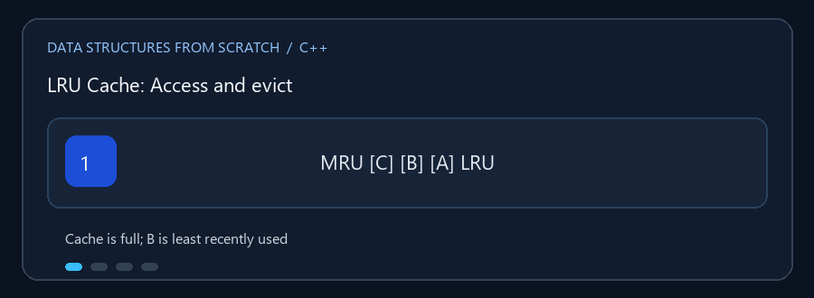

# LRU Cache

**English:** Combine fast key lookup with a recency order to choose what to
evict when storage is full. **بالعربي:** اجمع بين البحث السريع بالمفتاح
وترتيب الاستخدام عشان تعرف تحذف إيه لما الذاكرة تتملي.

## Animated walkthrough | شرح متحرك



Watch A move to the recent end after `get(A)`, then B leave when D is added.
تابع انتقال A لناحية الأحدث بعد `get(A)`، وبعدها خروج B لما نضيف D والسعة
تكون مليانة.

## Read the source step by step | اقرأ الكود بالترتيب

1. A hash table locates an entry by key; a linked list records recency.
   جدول التجزئة بيوصل للمفتاح، والقائمة بتحفظ ترتيب الاستخدام.
2. `get` returns the value and moves the entry to the most-recent end.
   `get` بترجع القيمة وبتنقل الإدخال لناحية الأحدث.
3. `contains` only checks membership; it does not make the key more recent.
   `contains` بتتأكد من الوجود من غير ما تغيّر ترتيب الاستخدام.
4. `put` updates or inserts; a full cache evicts the least-recent entry.
   `put` بتضيف أو تحدّث، ولو السعة خلصت بتحذف الأقل استخداماً.

**Try it / جرّب بنفسك:** Set capacity to 3; insert A, B, C; access A; then
insert D. Predict the evicted key before running each step. خلي السعة 3،
وأضف A وB وC، واستخدم A، ثم أضف D. توقّع المفتاح اللي هيتحذف قبل التنفيذ.

`LRU_Cache.cpp` يطبق ذاكرة مؤقتة ذات سعة محدودة وسياسة **Least Recently Used**:
عند امتلائها تُزال القيمة التي لم تُستخدم منذ أطول وقت.

## العمليات

- `put(key, value)`: إضافة أو تحديث مفتاح؛ التحديث يجعله الأحدث استخداماً.
- `get(key)`: إرجاع القيمة مع تحديث ترتيب الاستخدام.
- `contains(key)`: فحص وجود المفتاح دون تغيير ترتيب الاستخدام.
- الحذف، المسح، عرض العناصر من الأحدث إلى الأقدم، واستعلام السعة والحجم.

### 🎬 تحديث ترتيب LRU

```text
قبل الوصول إلى A:  الأكثر استخداماً -> [C] [B] [A] <- الأقل استخداماً
get(A):             الأكثر استخداماً -> [A] [C] [B] <- الأقل استخداماً
put(D) والسعة 3:    الأكثر استخداماً -> [D] [A] [C]  (حذف B)
```

الوصول والتحديث والإضافة والحذف `O(1)` في التصميم المعتاد باستخدام قائمة
مزدوجة التجاور وجدول تجزئة. الذاكرة `O(capacity)`.

## التشغيل

```powershell
g++ -std=c++17 -Wall -Wextra .\LRU_Cache.cpp -o .\lru_cache.exe
.\lru_cache.exe
```
