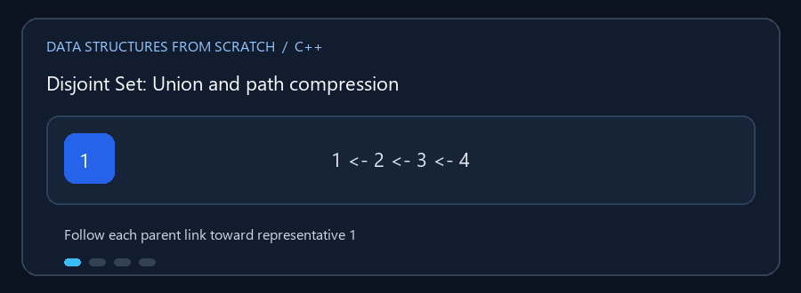

# Disjoint Set (Union-Find)

**English:** Track which elements belong to the same component and merge
components efficiently. **بالعربي:** اعرف العناصر اللي بتنتمي لنفس المجموعة
وادمج المجموعات بكفاءة.

## Animated walkthrough | شرح متحرك



Follow parent links to the representative, compress the path, then join two
components. تابع روابط الآباء للوصول للممثل، قصّر المسار، وبعدها ادمج
المجموعتين.

## Read the source step by step | اقرأ الكود بالترتيب

1. Initially every element is its own root. في البداية كل عنصر جذر لمجموعة
   مستقلة.
2. `find_set(x)` follows parent links to the representative. الدالة بتتبع
   روابط الآباء عشان توصل لممثل المجموعة.
3. Path compression redirects visited elements closer to the root. ضغط
   المسار بيقرّب العناصر اللي اتزارت من الجذر لتسريع المرات الجاية.
4. `unite(a,b)` finds both roots, then attaches the smaller component to the
   larger. `unite` بتجيب جذري المجموعتين وتربط الأصغر تحت الأكبر.
5. `connected` compares representatives, not just direct parents.
   الاتصال بيتحدد بمقارنة الممثلين، مش الأب المباشر.

**Limitation / ملاحظة:** Union-Find handles merging, but cannot generally
split a component after an arbitrary element is removed. البنية بتدعم الدمج،
لكن ما تقدرش عموماً تفصل مجموعة بعد حذف عنصر عشوائي منها.

`Disjoint_Set.cpp` يدير مجموعات منفصلة من العناصر، ويدعم معرفة ما إذا كان
عنصران في المجموعة نفسها ودمج مجموعتيهما.

## العمليات

- `find_set(x)`: إيجاد ممثل مجموعة العنصر؛ يستخدم ضغط المسار.
- `unite(a, b)`: دمج المجموعتين؛ يربط الأصغر بالأكبر.
- `connected(a, b)`: اختبار اتصال عنصرين.
- عدد عناصر المجموعة، إضافة عنصر، العرض، والمسح.

### 🎬 ضغط المسار ثم الدمج

```text
قبل find(4):  4 -> 3 -> 2 -> 1       (الممثل 1)
بعد find(4):  4 --------> 1          (الرابط أقصر)
unite(4, 7):  جذر مجموعة 7 يرتبط بجذر مجموعة 4
```

مع ضغط المسار والدمج حسب الحجم/الرتبة يكون الزمن شبه ثابت في المتوسط العملي:
`O(α(n))` لكل عملية، حيث `α` دالة بطيئة النمو جداً. الإضافة/التهيئة تستخدم
مساحة `O(n)`.

## التشغيل

```powershell
g++ -std=c++17 -Wall -Wextra .\Disjoint_Set.cpp -o .\disjoint_set.exe
.\disjoint_set.exe
```
