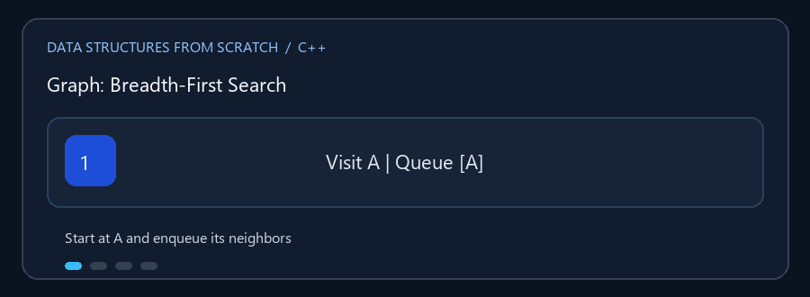

# Graph

**English:** A graph models vertices and edges. Understand direction and edge
weights before choosing a traversal or path algorithm. **بالعربي:** الـ Graph
بتمثل رؤوس وروابط؛ لازم تفهم الاتجاه والأوزان قبل اختيار خوارزمية.

## Animated walkthrough | شرح متحرك



The animation tracks BFS's queue from A: discovered neighbors are appended to
the back, then visited once. الـ GIF بتتابع Queue بتاعة BFS من A؛ كل جار جديد
بيدخل آخر الطابور، وكل رأس بيتزار مرة واحدة.

## Read the source step by step | اقرأ الكود بالترتيب

1. Check whether the graph is directed and weighted. حدّد هل الرسم موجه وهل
   الحواف ليها وزن.
2. The adjacency list stores outgoing edges for each vertex. قائمة التجاور
   بتسجل الحواف الخارجة من كل رأس.
3. BFS uses a queue and explores by distance; DFS goes deep before
   backtracking. BFS بتستخدم Queue وبتزور بالمستويات؛ DFS بتكمل فرعاً وبعدين
   ترجع.
4. Dijkstra updates tentative distances and reconstructs a shortest path.
   Dijkstra بتحدّث المسافات المؤقتة وبتكوّن أقصر مسار بعدين.
5. Negative weights are rejected because Dijkstra assumes non-negative
   weights. البرنامج بيرفض الأوزان السالبة لأن Dijkstra محتاجة أوزان غير سالبة.

**Practice / تدريب:** Run BFS and DFS from the same start vertex and compare
their visit orders. Change an edge weight and inspect Dijkstra's path and
distance. شغّل BFS وDFS من نفس الرأس وقارن الترتيب، وبعدها غيّر وزن حافة
وراجع المسافة والمسار.

`Graph.cpp` يمثل رسماً بيانياً برؤوس وحواف، مع دعم الأوزان والاتجاه بحسب
إعداد الرسم. يوفر إدارة الرؤوس والحواف، الاستعلام والعرض، والبحث في الرسم.

## الخوارزميات

- **BFS**: يزور مستوىً بعد مستوى باستخدام Queue.
- **DFS**: يستكشف مساراً إلى أقصى عمق قبل الرجوع.
- **Dijkstra**: يحسب أقصر مسارات من مصدر واحد عندما تكون الأوزان غير سالبة.
- البحث عن مسار/معلومات الحواف والاتصالات بحسب الخيارات المتاحة في القائمة.

### 🎬 BFS على رسم صغير

```text
       A
      / \
     B   C
     |
     D

Queue: [A] -> [B,C] -> [C,D] -> [D] -> []
زيارة:   A       B       C       D
```

ترتيب الزيارة قد يختلف حسب ترتيب الجيران المخزن، لكن BFS يزور بمسافات
متزايدة من نقطة البداية.

## التعقيد

مع قائمة تجاور، BFS وDFS `O(V + E)`. تنفيذ Dijkstra هنا بيمر على كل الرؤوس
للعثور على أقرب مسافة مؤقتة، لذلك تكلفته `O(V^2 + E)`، وليس heap-optimized.
المساحة `O(V + E)`.

## التشغيل

```powershell
g++ -std=c++17 -Wall -Wextra .\Graph.cpp -o .\graph.exe
.\graph.exe
```

راجع القائمة لمعرفة نمط الاتجاه والوزن والإدخال الذي يتوقعه البرنامج.
