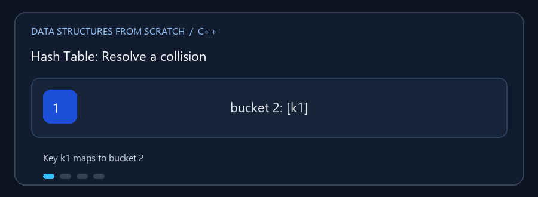

# Hash Tables

**English:** A hash function maps a key to a candidate slot; collisions need
a deliberate resolution strategy. **بالعربي:** دالة التجزئة بتحوّل المفتاح
لمكان مقترح، والتصادم محتاج طريقة معالجة صحيحة.

## Animated walkthrough | شرح متحرك



The GIF shows chaining: two keys map to bucket 2 and are linked there.
الـ GIF بتعرض Chaining: مفتاحين اتحولوا للخانة 2 واتربطوا فيها.

## Read the source step by step | اقرأ الكود بالترتيب

1. Compute a candidate slot from the key. احسب الخانة المقترحة للمفتاح.
2. Chaining stores colliding entries together; open addressing probes other
   slots and marks deleted slots with tombstones. Chaining بتجمع المتصادمين،
   أما Open Addressing بتفحص خانات تانية وبتعلّم الخانة المحذوفة بـ tombstone.
3. Cuckoo hashing has two candidate positions and may relocate an existing
   key. Cuckoo عندها مكانين محتملين وممكن تزحزح مفتاح موجود.
4. Rehashing allocates a differently sized table and reinserts entries,
   because capacity changes their candidate positions. إعادة التجزئة بتبني
   جدول بسعة مختلفة وبتعيد إدخال العناصر عشان أماكنها بتتغير.

**Important / مهم:** A collision is not lost data; lookup must still compare
keys and find the exact requested entry. التصادم مش فقدان بيانات؛ البحث لازم
يفحص المفاتيح ويلاقي الإدخال المطلوب بالضبط.

ثلاثة تطبيقات لتخزين أزواج المفتاح والقيمة والوصول إليها عبر دالة تجزئة.

## الملفات

- `Chaining_Hash_Table.cpp` — كل خانة تشير إلى سلسلة من الإدخالات المتصادمة.
  يتضمن إعادة التجزئة، الإضافة، البحث، التحديث، الحذف، وعرض السلاسل.
- `Open_Addressing_Hash_Table.cpp` — يخزن الإدخالات داخل الجدول ويبحث عن خانة
  أخرى عند التصادم؛ يعالج الحذف بعلامة tombstone. يتضمن أيضاً أمثلة مساعدة
  للتكرارات وTwo Sum.
- `Cuckoo_Hash_Table.cpp` — يستخدم موضعين محتملين لكل مفتاح ويزيح إدخالاً
  موجوداً عند التصادم، مع إعادة بناء الجدول عند الحاجة؛ يوفر البحث والإزالة
  وتحديث قيمة المفتاح الموجود أيضاً.

### 🎬 التصادم في Chaining

```text
hash(k1) = 2       hash(k2) = 2
الخانة 0:  -
الخانة 1:  -
الخانة 2:  [k1] -> [k2] -> nullptr
```

في العنونة المفتوحة تنتقل عملية البحث إلى خانات لاحقة؛ وفي Cuckoo تنتقل
الإدخالات بين مواضعها المحتملة.

## التعقيد

الإضافة والبحث والحذف `O(1)` متوقعاً عند توزيع جيد وتحميل مناسب؛ قد تصبح
`O(n)` في أسوأ حالة. إعادة التجزئة تكلف `O(n)` وقت حدوثها، وتكلفتها موزعة
على الإضافات عادةً. المساحة `O(n)`.

## التشغيل

ترجم ملفاً واحداً لكل تطبيق. مثال:

```powershell
g++ -std=c++17 -Wall -Wextra .\Chaining_Hash_Table.cpp -o .\chaining_hash.exe
.\chaining_hash.exe
```
