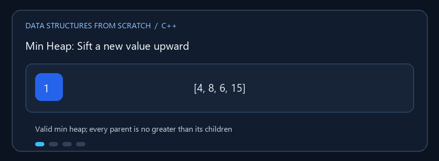

# Heaps

**English:** A heap keeps a useful parent/child ordering in a compact
array-backed tree. **بالعربي:** الـ Heap بتحافظ على ترتيب بين الأبناء والآباء،
وبتتخزن غالباً في مصفوفة بشكل مضغوط.

## Animated walkthrough | شرح متحرك



The animation appends 2 as a leaf and swaps it upward until every parent is
smaller. الـ GIF بتضيف 2 كورقة، وبعدها تطلعها بتبديلات لحد ما كل أب يبقى
أصغر من أبنائه.

## Read the source step by step | اقرأ الكود بالترتيب

1. For a zero-based heap array, the parent and child positions follow index
   formulas. في مصفوفة heap بفهرسة تبدأ من صفر، مكان الأب والأبناء بيتحدد
   بمعادلات على الفهرس.
2. Insert at the next free leaf, then `sift_up`. أضف العنصر في آخر مكان فاضي
   وبعدين نفّذ `sift_up`.
3. Extract the root by moving the last entry to the root, then `sift_down`.
   لإزالة الجذر، انقل آخر عنصر مكانه وبعدها نفّذ `sift_down`.
4. `Indexed_Heap.cpp` additionally maps IDs to current heap positions, so a
   known ID can be updated or removed. الملف المفهرس بيربط المعرّف بمكانه
   الحالي عشان يقدر يحدّثه أو يحذفه.
5. In this priority queue, larger priority values come first; equal priorities
   keep insertion order. في Priority Queue هنا الأولوية الأكبر تطلع أولاً،
   والمتساوي يحتفظ بترتيب الإدخال.

**Do not confuse / ما تخلطش:** A heap is not a fully sorted array. Only the
root is guaranteed to be the next minimum/maximum. الـ Heap مش مصفوفة مرتبة
بالكامل؛ الضمان الأساسي هو إن الجذر هو العنصر التالي حسب الأولوية.

الأكوام تمثل شجرة ثنائية كاملة غالباً بمصفوفة، وتحافظ على ترتيب جزئي بين الأب
وأبنائه. هذه الأمثلة توضح أنواعاً واستخدامات متعددة.

## الملفات

- `Binary_Heap.cpp` — تطبيق heap عام والعمليات الأساسية.
- `Min_Heap.cpp` — أصغر عنصر في الجذر، مع إدخال وإزالة وبناء/عرض heap.
- `Priority_Queue.cpp` — عناصر ذات أولوية، مع إدخال وإزالة الأعلى أولوية وpeek.
- `Indexed_Heap.cpp` — أولوية مرتبطة بمعرّف؛ البحث عن ID وتغيير أولويته
  وإزالته مدعوم بجدول مواقع.

### 🎬 إدخال في Min Heap

```text
قبل:           [4, 8, 6, 15]
إضافة 2:       [4, 8, 6, 15, 2]
sift-up:       [4, 8, 2, 15, 6]
sift-up:       [2, 8, 4, 15, 6]
```

بعد الإضافة يصعد العنصر حتى يعود شرط heap صحيحاً. عند إزالة الجذر يوضع آخر
عنصر مكانه ثم يهبط.

## التعقيد

| العملية | Min/Binary/Priority Heap | Indexed Heap |
|---|---:|---:|
| peek | `O(1)` | `O(1)` |
| insert / extract / تغيير الأولوية | `O(log n)` | `O(log n)` |
| البحث عن قيمة/ID | `O(n)` | `O(1)` متوقع للعثور على الموقع |
| بناء heap من عناصر | `O(n)` | بحسب المسار المستخدم |

## التشغيل

كل ملف مستقل. مثال:

```powershell
g++ -std=c++17 -Wall -Wextra .\Min_Heap.cpp -o .\min_heap.exe
.\min_heap.exe
```
