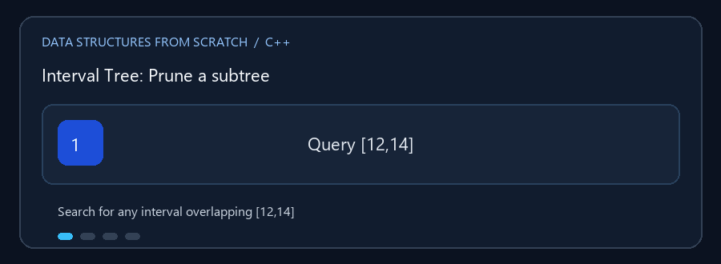

# Interval Tree

**English:** Store ranges, then skip subtrees whose endpoints cannot overlap a
query. **بالعربي:** خزّن فترات واستبعد الفروع اللي مستحيل تتداخل مع الاستعلام.

## Animated walkthrough | شرح متحرك



For query `[12,14]`, a subtree with `maxHigh = 8` cannot reach the query.
الاستعلام `[12,14]` والفرع اللي `maxHigh` فيه 8 مستحيل يوصل لبداية 12، فمش
محتاجين نفتشه.

## Read the source step by step | اقرأ الكود بالترتيب

1. Nodes are ordered by `(low,id)`; IDs are unique. العقد مرتبة حسب
   `(low,id)` والمعرّفات فريدة.
2. Each node stores `maxHigh`, the largest endpoint in its subtree. كل عقدة
   بتخزن أكبر نهاية فترة موجودة في فرعها.
3. Intervals overlap when `stored.low <= query.high` and
   `query.low <= stored.high`. الفترة تتداخل لما بداية كل واحدة ما تعديش
   نهاية التانية.
4. If `maxHigh < query.low`, that subtree can be pruned. لو `maxHigh` أصغر
   من بداية الاستعلام نقدر نستبعد الفرع بالكامل.
5. The public search finds one match; duplicate IDs and invalid ranges are
   rejected. البحث بيرجع نتيجة واحدة، وبيترفض المعرّف المكرر أو الفترة الغلط.
6. AVL rotations preserve balance and require refreshing the stored maximum.
   دوران AVL بيحافظ على التوازن ولازم بعده تحديث أكبر نهاية.

`Interval_Tree.cpp` ينظم فترات `[low, high]` في شجرة AVL، ويحتفظ في العقدة
بأكبر حد أعلى `maxHigh` في الفرع. هذه المعلومة تساعد على استبعاد الفروع التي
لا يمكن أن تتداخل مع الفترة المطلوبة.

## العمليات

يحتوي التطبيق على إضافة فترة بمعرّف فريد، إيجاد فترة متداخلة واحدة مع الاستعلام،
إزالة الفترة بالمعرّف، والعرض المرتب حسب بداية الفترة. الفترتان تتداخلان إذا
لم تكن إحداهما تقع بالكامل قبل الأخرى؛ الحدود المتساوية تُعد تداخلاً.

### 🎬 استبعاد فرع

```text
العقدة: [10, 20]       maxHigh للفرع الأيسر = 8
الفترة المطلوبة: [12, 14]

8 < 12  => لا يمكن لأي فترة في الفرع الأيسر أن تتداخل؛ تجاهل هذا الفرع.
افحص العقدة ثم الفرع الذي قد يحتوي قيمة مناسبة.
```

الإضافة والحذف `O(log n)` بسبب توازن AVL. البحث عن تداخل يستفيد من
`maxHigh` pruning، لكنه قد يصل إلى `O(n)` في أسوأ حالة. المساحة `O(n)`.

## التشغيل

```powershell
g++ -std=c++17 -Wall -Wextra .\Interval_Tree.cpp -o .\interval_tree.exe
.\interval_tree.exe
```
