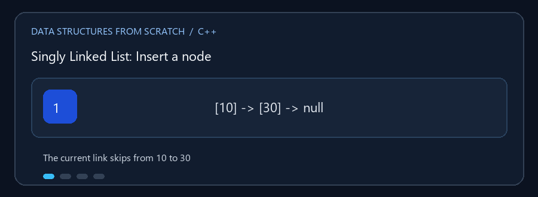

# Linked Lists

**English:** Nodes are connected by pointers rather than adjacent array
positions. **بالعربي:** العناصر عقد مترابطة بمؤشرات، مش لازم تكون جنب بعضها
في الذاكرة.

## Animated walkthrough | شرح متحرك



Insert 20 between 10 and 30: first link the new node to 30, then link 10 to
the new node. لإدراج 20 بين 10 و30، اربط الجديدة بـ30 الأول، وبعدها اربط 10
بالعقدة الجديدة.

## Read the source step by step | اقرأ الكود بالترتيب

1. Traverse from `head` using `next`. In a circular list, stop when the
   traversal returns to its start. ابدأ من `head` واتبع `next`؛ في الدائرية
   توقف لما ترجع لنقطة البداية.
2. A singly linked node only points forward. الأحادية رابطها للأمام فقط.
3. A doubly linked update must maintain both `next` and `previous`, including
   head/tail cases. المزدوجة لازم تحدث الرابطين وتتعامل مع أول وآخر عقدة.
4. The circular tail points back to the head; waiting for `nullptr` would
   loop forever. ذيل القائمة الدائرية بيرجع للرأس؛ انتظار `nullptr` هيعمل
   loop لا نهائي.
5. Save the successor before unlinking a node. احفظ مؤشر العقدة التالية قبل
   فصل العقدة المطلوب حذفها.

**Complexity / التعقيد:** Insert after a known node is `O(1)`; searching for a
value or index takes `O(n)`. الإدراج بعد عقدة معروفة `O(1)`، أما البحث عن
قيمة أو فهرس فـ `O(n)`.

ثلاثة أشكال للقائمة المرتبطة؛ كل عقدة تحمل قيمة وروابط بدلاً من تخزين العناصر
متجاورة في مصفوفة.

## الملفات

- `Singly_Linked_List.cpp` — رابط إلى العقدة التالية.
- `Doubly_Linked_List.cpp` — رابطان إلى السابقة والتالية؛ يدعم المرور للأمام
  والخلف.
- `Circular_Linked_List.cpp` — نهاية القائمة تعود إلى بدايتها.

تتضمن التطبيقات إنشاء القائمة والإضافة والإدراج والحذف والبحث وتعديل القيمة
والعرض وعمليات مساعدة أخرى في القوائم التفاعلية.

### 🎬 إدراج بعد العقدة الأولى

```text
قبل:   head -> [10] -> [30] -> nullptr
عقدة:                    [20]
وصل:   head -> [10] -> [20] -> [30] -> nullptr
```

في القائمة الأحادية نحدّث رابط العقدة السابقة ثم رابط العقدة الجديدة. احرص على
عدم فقدان المؤشر إلى الجزء المتبقي من القائمة أثناء تغيير الروابط.

## التعقيد

البحث والوصول بالفهارس `O(n)`. الإضافة/الحذف عند عقدة معروفة `O(1)`، لكن
العثور على الموضع المطلوب قد يكلف `O(n)`. القوائم المزدوجة تستخدم مساحة إضافية
لرابط `previous`.

## التشغيل

```powershell
g++ -std=c++17 -Wall -Wextra .\Singly_Linked_List.cpp -o .\singly_list.exe
.\singly_list.exe
```

شغّل كل نوع منفرداً لتجربة اختلاف الروابط والحركة.
