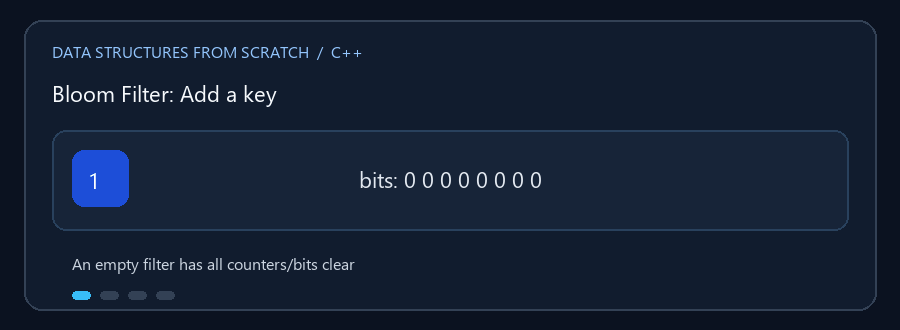

# Probabilistic Data Structures

**English:** Bloom filters use compact bit storage for fast approximate
membership checks. **بالعربي:** Bloom Filter بتستخدم بتات قليلة عشان تختبر
وجود عنصر بسرعة وبشكل احتمالي.

## Animated walkthrough | شرح متحرك



Each hash function selects a bit; adding a key turns the selected bits on.
كل دالة تجزئة بتختار بت، وإضافة المفتاح بتضبط البتات دي.

## Read the source step by step | اقرأ الكود بالترتيب

1. Add a key by hashing it to multiple bit positions. الإضافة بتحول المفتاح
   لعدة أماكن بتات.
2. Any zero bit means definitely absent; all selected bits set means possibly
   present. لو أي بت صفر يبقى غائب بالتأكيد؛ لو كلهم واحد ممكن يكون موجود.
3. Different keys can share bits, causing a false positive. مفاتيح مختلفة
   ممكن تشترك في نفس البتات وتعمل إيجابية كاذبة.
4. Counting Bloom Filter uses counters to support removal. نسخة العدادات
   بتسمح بالحذف.
5. Removing a key that was never added may decrement counters shared by other
   keys. حذف مفتاح مش متضاف ممكن يقلل عدادات مستخدمة لمفاتيح تانية.

**Use case / الاستخدام:** Treat a positive answer as a hint and confirm it in
an exact store when correctness matters. اعتبر النتيجة الإيجابية احتمال،
وأكّدها من مخزن دقيق لو صحة القرار مهمة.

## الملفات

- `Bloom_Filter.cpp` — بنية احتمالية موفرة للمساحة لاختبار الانتماء.
- `Counting_Bloom_Filter.cpp` — يستخدم عدادات بدلاً من بتات مفردة، فيتيح
  إزالة التكرارات مع بقاء احتمال الخطأ.

النتيجة السلبية تعني أن العنصر غير موجود بالتأكيد. النتيجة الإيجابية تعني أنه
قد يكون موجوداً، وقد تكون **إيجابية كاذبة**؛ لا توجد سلبية كاذبة ما دامت
الإضافات والإزالات متسقة.

### 🎬 إضافة عنصر

```text
البتات:       0 0 0 0 0 0 0 0
hash1("cat"):         ^  (الموضع 4)
hash2("cat"):             ^ (الموضع 6)
بعد الإضافة:   0 0 0 0 1 0 1 0
```

يحسب Bloom Filter عدة مواقع ويفعّلها. الفحص يختبرها جميعاً. في Counting Bloom
تزداد العدادات عند الإضافة وتنقص عند الإزالة؛ العدادات المحدودة قد تتشبع.

## التعقيد

إضافة أو اختبار عنصر `O(k)`، حيث `k` عدد دوال التجزئة. المساحة `O(m)`، حيث
`m` عدد البتات أو العدادات.

## ملاحظة استخدام

Bloom Filter لا يخزن المفاتيح الأصلية ولا يتيح استرجاعها؛ لا تستخدمه وحده
كمصدر حقيقة إذا كان القرار يتطلب يقيناً بالإيجاب.

## التشغيل

```powershell
g++ -std=c++17 -Wall -Wextra .\Bloom_Filter.cpp -o .\bloom_filter.exe
.\bloom_filter.exe
```
