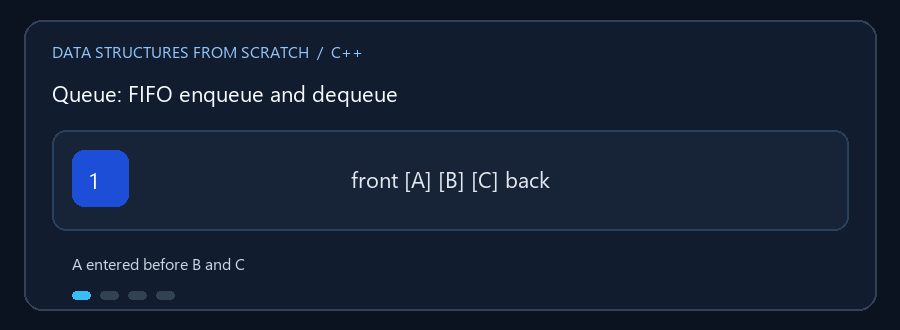

# Queues and Deque

**English:** A queue is FIFO; a deque supports operations at both ends.
**بالعربي:** الـ Queue أول داخل أول خارج، والـ Deque بتدعم التعامل من الطرفين.

## Animated walkthrough | شرح متحرك



A enters first and leaves first; new D joins at the back. A يدخل الأول ويخرج
الأول، والعنصر D الجديد يدخل من الخلف.

## Read the source step by step | اقرأ الكود بالترتيب

1. Enqueue at the back; dequeue from the front. `enqueue` بتضيف من الخلف
   و`dequeue` بتحذف من الأمام.
2. Static Queue has fixed capacity; Dynamic Queue grows when needed.
   الثابت سعته محدودة؛ والديناميكي بيكبر وقت الحاجة.
3. Linked Queue allocates nodes; a circular array reuses slots. القائمة
   المرتبطة بتضيف عقد؛ والمصفوفة الدائرية بتعيد استخدام الخانات.
4. Deque supports both ends and includes a palindrome example. الـ Deque
   بتدعم الطرفين وفيها مثال لفحص Palindrome.
5. Check empty/full before removing or adding. اتأكد من حالة الفراغ أو
   الامتلاء قبل الحذف أو الإضافة.

**Practice / تدريب:** Enqueue A, B, C; dequeue once; enqueue D. FIFO order is
now B, C, D. أضف A وB وC، احذف مرة، وأضف D؛ الترتيب يبقى B ثم C ثم D.

## الملفات

- `Static_Queue.cpp` — Queue بسعة ثابتة.
- `Dynamic_Queue.cpp` — Queue تكبر عند الحاجة.
- `Linked_List_Queue.cpp` — Queue بعقد مرتبطة.
- `Deque.cpp` — طابور مزدوج النهاية يسمح بالإضافة والإزالة من الطرفين.

الـ Queue العادية تعمل بمبدأ FIFO: أول عنصر يدخل هو أول عنصر يخرج. الـ Deque
تسمح بالعمل من الأمام والخلف، وتعرض كذلك عكس الطابور وفحص ما إذا كان النص
Palindrome. أمثلة الطوابير تشمل مسائل ترتيب/محاكاة بحسب خيارات كل برنامج.

### 🎬 FIFO

```text
enqueue(A), enqueue(B), enqueue(C)
front -> [A] [B] [C] <- back
dequeue() يعيد A
front -> [B] [C] <- back
```

في الطابور الدائري يتحرك المؤشر بالالتفاف عند نهاية التخزين، فلا يلزم نقل
العناصر بعد كل إزالة.

## التعقيد

الإضافة والإزالة وقراءة المقدمة `O(1)` في التنفيذ المناسب. البحث والعرض `O(n)`.
السعة الثابتة تحد من عدد العناصر؛ الديناميكية قد تحتاج `O(n)` عند إعادة
التخصيص، لكنها توفر إضافة `O(1)` استهلاكياً. القائمة تستخدم `O(n)` مساحة.

## التشغيل

```powershell
g++ -std=c++17 -Wall -Wextra .\Dynamic_Queue.cpp -o .\dynamic_queue.exe
.\dynamic_queue.exe
```
