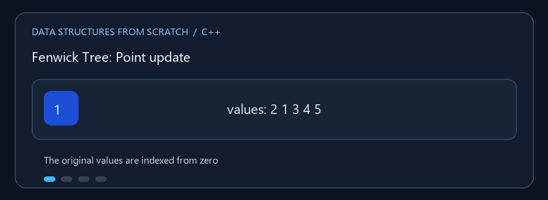

# Range Queries

**English:** Answer subarray questions without scanning every value for
every query. **بالعربي:** جاوب عن استعلامات نطاق من غير فحص كل العناصر كل مرة.

## Animated walkthrough | شرح متحرك



Increase array index 2, then combine stored partial sums for a prefix query.
زوّد قيمة الفهرس 2، وبعدها اجمع المجاميع الجزئية للإجابة عن استعلام بادئة.

## Read the source step by step | اقرأ الكود بالترتيب

1. Fenwick stores partial sums; a point update touches logarithmically many
   cells. Fenwick بتخزن مجاميع جزئية وتحديث نقطة بيغير خانات قليلة.
2. Segment Tree combines child summaries for a range query. Segment Tree
   بتجمع ملخصات الأبناء للإجابة عن نطاق.
3. Sparse Table precomputes power-of-two ranges and suits unchanged data.
   Sparse Table بتحسب نطاقات مسبقاً ومناسبة للبيانات اللي مش بتتغير.
4. This Sparse Table returns minimum, maximum, and GCD together. الاستعلام
   بيرجع أقل وأكبر قيمة وGCD معاً.
5. Check zero-based indices and inclusive `[left,right]` bounds. راجع إن
   الفهرسة تبدأ من صفر وإن الطرفين داخل النطاق.

**Choose / الاختيار:** Frequent updates favor Fenwick/Segment Tree; many
queries on static data favor Sparse Table. التحديث المتكرر يناسب Fenwick أو
Segment Tree، والاستعلامات على بيانات ثابتة تناسب Sparse Table.

ثلاث طرق لتخزين قيم مصفوفة والإجابة عن استعلامات نطاق. الفهارس في الشروح
والاستعلامات تبدأ من الصفر؛ تحقق من حدود `[left, right]` التي يطلبها البرنامج.

## الملفات والفرق

- `Fenwick_Tree.cpp` — تحديث نقطة واستعلام مجموع بادئة/نطاق بكفاءة.
- `Segment_Tree.cpp` — تحديث نقطة واستعلامات نطاق تشمل الملخصات التي يوفرها
  التطبيق، مثل المجموع والحدين الأدنى والأعلى.
- `Sparse_Table.cpp` — بناء جداول مسبقة للاستعلامات على نطاق ثابت؛ التطبيق
  يحسب الاستعلامات الموثقة داخله، ومنها minimum وmaximum وGCD.

### 🎬 Fenwick: إضافة قيمة إلى موضع

```text
الفهرس الأصلي:   0  1  2  3  4
القيم:           2  1  3  4  5
تحديث index 2:   +2
المصفوفة:        2  1  5  4  5
مجاميع النطاق:   prefix(2) = 2 + 1 + 5 = 8
```

داخلياً يعدّل Fenwick عدة خانات تمثل نطاقات متداخلة؛ لا يخزن كل مجموع نطاق
ممكن بشكل منفصل.

## التعقيد

| البنية | البناء | تحديث نقطة | استعلام نطاق | الذاكرة |
|---|---:|---:|---:|---:|
| Fenwick | `O(n)` أو `O(n log n)` حسب البناء | `O(log n)` | `O(log n)` للمجموع | `O(n)` |
| Segment Tree | `O(n)` | `O(log n)` | `O(log n)` | `O(n)` |
| Sparse Table | `O(n log n)` | غير مخصص للتحديث | `O(1)` عادةً للـ idempotent queries | `O(n log n)` |

Sparse Table مناسب عندما لا تتغير البيانات كثيراً؛ Fenwick وSegment Tree
أنسب للتحديثات.

## التشغيل

```powershell
g++ -std=c++17 -Wall -Wextra .\Segment_Tree.cpp -o .\segment_tree.exe
.\segment_tree.exe
```
