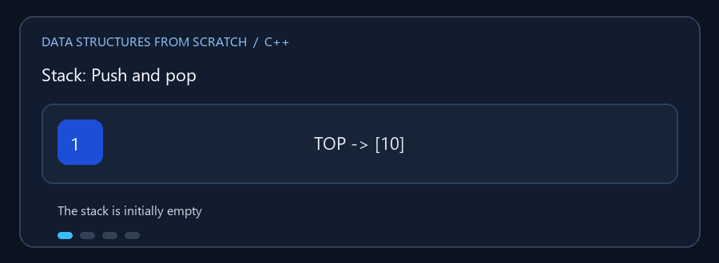

# Stacks

**English:** A stack follows LIFO: the newest value is removed first.
**بالعربي:** الـ Stack بتطبق LIFO: آخر عنصر يدخل هو أول عنصر يخرج.

## Animated walkthrough | شرح متحرك



Every push becomes the top item; pop removes that item. كل `push` بتحط
العنصر الجديد فوق، و`pop` بتحذف العنصر الموجود فوق.

## Read the source step by step | اقرأ الكود بالترتيب

1. Add and remove items from the top only. ضيف واحذف من فوق فقط.
2. `push` places a value there; `pop` returns and removes it. `push` بتضيف
   و`pop` بترجع القيمة وبتحذفها.
3. Static, dynamic, and linked stacks differ in storage, not LIFO behavior.
   الأنواع بتختلف في التخزين مش في مبدأ LIFO.
4. Example applications include bracket checking, text reversal, and
   decimal-to-binary conversion. التطبيقات تشمل فحص الأقواس وعكس النص
   والتحويل من عشري لثنائي.
5. Handle an empty pop (underflow) and a full static stack. اتعامل مع الحذف
   من Stack فاضية ومع امتلاء النسخة الثابتة.

ثلاثة تطبيقات لمبدأ LIFO: آخر عنصر يدخل هو أول عنصر يخرج.

## الملفات

- `Static_Stack.cpp` — سعة محددة مسبقاً.
- `Dynamic_Stack.cpp` — تخزين قابل للنمو.
- `Linked_List_Stack.cpp` — عقد مرتبطة بدلاً من مصفوفة.

تعرض البرامج عمليات المكدس، وتستخدمه أيضاً في أمثلة مثل فحص توازن الأقواس،
عكس النص، والتحويل من عشري إلى ثنائي بحسب الملف.

### 🎬 Push وPop

```text
push(10):  TOP -> [10]
push(20):  TOP -> [20] -> [10]
push(30):  TOP -> [30] -> [20] -> [10]
pop():     يعيد 30، ويصبح TOP -> [20] -> [10]
```

## التعقيد

`push`, `pop`, و`top/peek` `O(1)` عادةً. البحث أو العرض `O(n)`. تمدد المصفوفة
قد يكلف `O(n)` في عملية بعينها، لكنه `O(1)` استهلاكياً عند التضاعف.

## التشغيل

```powershell
g++ -std=c++17 -Wall -Wextra .\Dynamic_Stack.cpp -o .\dynamic_stack.exe
.\dynamic_stack.exe
```
