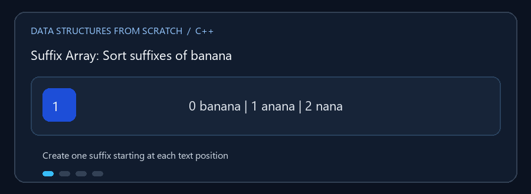

# Text Data Structures

**English:** The three structures support text edits and substring queries in
different ways. **بالعربي:** كل بنية هنا بتعالج تعديل النص أو البحث عن
المقاطع بطريقة مختلفة.

## Animated walkthrough | شرح متحرك



The GIF builds and sorts all suffixes of `banana`. الـ GIF بتكوّن كل اللواحق
لكلمة `banana` وبتعرض ترتيبها الأبجدي.

## Read the source step by step | اقرأ الكود بالترتيب

1. Rope stores text chunks in tree nodes; edits split or join chunks. Rope
   بتخزن أجزاء النص في عقد، والتعديل بيقسم أو يدمج الأجزاء.
2. Suffix Array stores starting indices of sorted suffixes. Suffix Array
   بتحفظ بدايات اللواحق مرتبة.
3. Suffix Automaton builds states/transitions and follows suffix links.
   Suffix Automaton بتبني حالات وانتقالات وبتتبع روابط اللواحق.
4. Distinguish occurrence count from the number of distinct substrings.
   فرّق بين مرات ظهور النمط وعدد المقاطع المختلفة.
5. Rebuild/append changes the source text and its derived index. الإضافة
   وإعادة البناء بتغير النص والبنية المحسوبة منه.

ثلاث بنيات مختلفة لخدمة النصوص: تحرير النصوص الكبيرة، والبحث عن الأنماط،
وتحليل السلاسل الفرعية.

## الملفات

- `Rope.cpp` — نص مقسم إلى عقد/أجزاء؛ يدعم الإضافة والحذف واستخراج مقطع
  والوصول بحسب الفهرس.
- `Suffix_Array.cpp` — ترتيب بدايات اللواحق lexicographically، مع LCP والبحث
  عن النمط وأطول جزء متكرر بحسب خيارات التطبيق.
- `Suffix_Automaton.cpp` — آلة حالات تمثل السلاسل الفرعية، وتدعم فحص النمط،
  عدّ مرات ظهوره، عدّ السلاسل الفرعية المميزة، أطول سلسلة متكررة، وأطول سلسلة
  مشتركة بين نصين. يمكن إضافة نص أو إعادة بناء الآلة لنص جديد.

### 🎬 Suffix Array لنص `banana`

```text
اللواحق:
0 banana       3 ana
1 anana        4 na
2 nana         5 a

بعد الترتيب:
5: a
3: ana
1: anana
0: banana
4: na
2: nana

البحث عن "ana" يضيّق مجال اللواحق المرتبة حتى يعثر على البدايات المطابقة.
```

## التعقيد

تختلف الكلفة حسب العملية. بناء Suffix Array في هذا الملف يستخدم sorting
متكرر للرتب وتكلفته `O(n log^2 n)`؛ وبناء LCP `O(n)` ثم جدول LCP يستهلك
`O(n log n)`. البحث عن نمط طوله `m` يعثر على مجاله بوقت `O(m log n)` ثم
يعرض النتائج. Suffix Automaton يخزن الحالات والانتقالات؛ `map` المرتبة تضيف
كلفة بحث لوغاريتمية حسب عدد الانتقالات. Rope تعتمد عملياتها على شكل الشجرة
وموقع التعديل؛ لا تفترض أنها أسرع دائماً من `std::string`.

**Complexity note / ملاحظة التعقيد:** These are bounds for the implementations
in these files, not universal bounds for every Suffix Array, Automaton, or
Rope implementation. دي حدود مرتبطة بالتنفيذ الموجود هنا، مش قاعدة موحدة لكل
تطبيق لهذه البنى.

## التشغيل

```powershell
g++ -std=c++17 -Wall -Wextra .\Suffix_Array.cpp -o .\suffix_array.exe
.\suffix_array.exe
```
