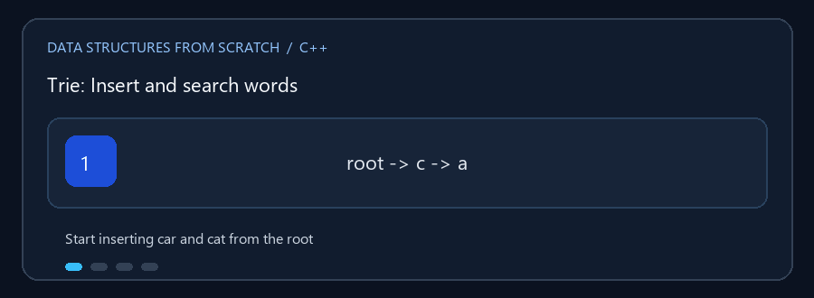

# Trie

**English:** A Trie shares prefixes but marks complete words separately.
**بالعربي:** الـ Trie بتشارك بادئات الكلمات وبتعلّم نهاية كل كلمة كاملة.

## Animated walkthrough | شرح متحرك



`car` and `cat` share `ca`; ending markers identify the words, not the prefix
alone. `car` و`cat` بيشتركوا في `ca`؛ علامات النهاية بتحدد الكلمتين مش
البادئة لوحدها.

## Read the source step by step | اقرأ الكود بالترتيب

1. Follow one edge for each character from the root. اتبع حافة لكل حرف من
   الجذر.
2. Insertion marks the last node as a complete word. الإضافة بتعلم آخر عقدة
   إنها نهاية كلمة.
3. `starts_with` checks a path; `search` also requires a word-ending marker.
   `starts_with` بتفحص المسار، لكن `search` محتاجة علامة نهاية الكلمة.
4. Erase removes that marker and prunes nodes unused by other words. الحذف
   بيشيل العلامة وينضف العقد اللي مالهاش استخدام تاني.
5. Suggestions traverse the prefix branch up to the result limit.
   الاقتراحات بتمشي في فرع البادئة لحد العدد المطلوب.

**Try / جرّب:** Insert `car` and `cat`; search each word, then search `ca` and
check whether it is a prefix. أضف `car` و`cat` وابحث عن كل كلمة وعن `ca`،
وبعدين اختبر `ca` كبادئة.

`Trie.cpp` يخزن الكلمات على شكل مسارات من الأحرف المشتركة. كل عقدة تمثل
بادئة؛ علامة نهاية الكلمة تميز الكلمة الكاملة عن بادئة لكلمة أطول.

## العمليات

إضافة كلمة، البحث عن كلمة كاملة، اختبار وجود بادئة، حذف كلمة مع إزالة العقد
التي لم تعد مطلوبة، واقتراح كلمات تبدأ ببادئة وعرض معلومات الشجرة.

### 🎬 كلمات تشترك في بادئة

```text
إضافة "car" و"cat":
root -> c -> a -> r* 
                 \
                  t*

* نهاية كلمة
starts_with("ca") = true
search("ca")      = false
```

`search` يتطلب علامة نهاية كلمة؛ وجود المسار وحده لا يكفي.

## التعقيد

البحث والإضافة والحذف `O(L)` لعدد أحرف الكلمة `L`، مع اعتماد المساحة على
مجموع البادئات الفريدة. عرض الاقتراحات يتناسب مع الجزء الذي يتم اجتيازه وعدد
النتائج.

## التشغيل

```powershell
g++ -std=c++17 -Wall -Wextra .\Trie.cpp -o .\trie.exe
.\trie.exe
```
